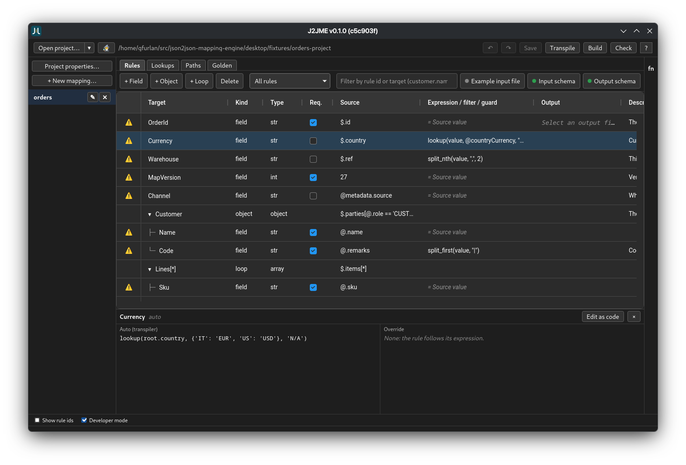

<a name="json2json-mapping-engine" />
#  json2json-mapping-engine

[](https://git.giacomofurlan.name/elegos/json2json-mapping-engine/releases)
[](https://git.giacomofurlan.name/elegos/json2json-mapping-engine/actions?workflow=ci.yml)


 <!-- Done -->
 <!-- Done -->

A **compiled, hard-typed** JSON-to-JSON mapping engine designed for polyglot enterprise runtimes. Write declarative, target-agnostic mapping rules; the compiler validates them against strict JSON Schemas and transpiles them into optimized, native artifacts for any supported backend.

> [!NOTE]
> **No runtime interpreters. No framework overhead. Just deterministic, production-ready native code tailored for your specific execution environment.**

<a name="contents" />
## 📑 Contents
- [🔀 json2json-mapping-engine](#json2json-mapping-engine)
  - [📑 Contents](#contents)
  - [🏛️ Why This Engine Exists](#why-this-engine-exists)
  - [🎯 Supported \& Upcoming Backends](#supported-upcoming-backends)
  - [🧩 How it works](#how-it-works)
  - [🎯 Targets](#targets)
  - [🖥️ Desktop tool](#desktop-tool)
  - [🧩 Code Generation: Before \& After](#code-generation-before-after)
  - [📦 Install](#install)
  - [🚀 Quick start](#quick-start)
  - [🤖 CI](#ci)
  - [🛠️ Development](#development)
  - [📚 Documentation](#documentation)
  - [📜 Open Source License \& The Commercial Exception](#open-source-license-the-commercial-exception)

<a name="why-this-engine-exists" />
## 🏛️ Why This Engine Exists

In modern enterprise architectures, data mapping between decoupled systems—ranging from legacy transactional databases to distributed big data pipelines—is a major source of technical debt, silent production failures, and performance bottlenecks. 

Traditional approaches fall into two flawed categories:
1. **Runtime Interpretation (DSLs & Heavy Frameworks):** Interpreted mapping engines bypass static code analysis, introduce compute overhead, and delay error discovery until the code hits live production under heavy load.
2. **Inconsistent Hand-Written Code:** Manual implementation leads to fragmented logic, security vulnerabilities, and unmaintainable variations across repositories, especially when AI code-generation is used without strict boundaries.

`json2json-mapping-engine` solves this by decoupling the **mapping design** from the **execution runtime**. It moves 100% of the type-checking and validation complexity to the compile-time layer. If a mapping rule compiles, it is mathematically guaranteed to be consistent with your schemas.

---

<a name="supported-upcoming-backends" />
## 🎯 Supported & Upcoming Backends

The engine architecture separates the front-end (rule transpilation and schema verification) from the back-end (code generation). This allows it to target entirely different computing paradigms with the same set of rules:

*   **Python** (✅ Complete): Emits clean, dependency-free Python modules leveraging native data structures.
*   **PL/SQL / Oracle** (✅ Complete): Emits optimized, high-performance database packages, eliminating the need for unsafe dynamic SQL evaluation or mid-tier roundtrips.
*   **Java** (⏳ Planned): Target for cloud-native microservices and robust backend ecosystems.
*   **PySpark** (⏳ Planned): Target for big data engineering, translating schema mappings into optimized DataFrame transformations for distributed clusters.

<a name="how-it-works" />
## 🧩 How it works

```
.fn.yaml ──► transpiler ──► .map.py ──┐
                                      ├──► compiler ──► target artifact (e.g. PL/SQL package)
JSON Schemas ──► stubs ───────────────┘
```

Everything up to the type checker is target-agnostic; only the backend emits code.
Project settings live in `mapper.toml`.

<a name="targets" />
## 🎯 Targets

| Target | State |
|---|---|
| PL/SQL (Oracle) | ✅ reference implementation, see [`docs/backends/plsql.md`](docs/backends/plsql.md) |
| Python | ✅ complete (generated modules need Python 3.10+) |

Writing another one: [`docs/backends/writing-a-backend.md`](docs/backends/writing-a-backend.md).

<a name="desktop-tool" />
## 🖥️ Desktop tool

A Tauri app (Linux AppImage, Windows installer and portable zip, macOS dmg) to edit rules in a
grid, try a mapping, run the checks and use git (commit, pull, push) without leaving it.

> [!NOTE]
Don't author files in bare text editors, do it in a feature-rich, hint-supported application!

See [`desktop/README.md`](desktop/README.md).



<a name="code-generation-before-after" />
## 🧩 Code Generation: Before & After

Instead of interpreting rules at runtime, `json2json-mapping-engine` takes a declarative functional mapping and compiles it into the exact code a senior engineer would write manually.

> [!NOTE]
The following are mere examples, and might differ from the final result, depending on the engine version.

### 1. The Source Rule (`orders.fn.yaml`)
```yaml
mapping:
  target: "CustomerOrder"
  rules:
    - field: "order_id"
      transform: "source.id.upper()"
    - field: "total_amount"
      transform: "source.price * source.quantity"
```

### 2. The Compiled Outputs (Zero Dependencies)

#### 🔹 Target: PL/SQL (Optimized for Oracle Database)
```sql
CREATE OR REPLACE PACKAGE BODY pkg_orders_mapping AS
   PROCEDURE map_json(p_source IN CLOB, p_target OUT CLOB) IS
   BEGIN
      -- Pure native PL/SQL JSON features. No EXECUTE IMMEDIATE, no overhead.
      SELECT JSON_OBJECT(
                'order_id'     VALUE UPPER(JSON_VALUE(p_source, '$.id')),
                'total_amount' VALUE (TO_NUMBER(JSON_VALUE(p_source, '$.price')) * TO_NUMBER(JSON_VALUE(p_source, '$.quantity')))
             )
      INTO p_target FROM DUAL;
   END map_json;
END pkg_orders_mapping;
```

#### 🔹 Target: Python (Clean & Type-Hinted)
```python
def map_json(source: dict) -> dict:
    # Pure native Python, fully compliant with your target JSON Schema
    return {
        "order_id": str(source["id"]).upper(),
        "total_amount": float(source["price"]) * int(source["quantity"])
    }
```

<a name="install" />
## 📦 Install

- 📥 **Desktop tool and CLI**: download from the project's releases page (see the release badge).
  - 🪟 Windows: the installer isn't code-signed yet, so SmartScreen will warn "Windows protected
    your PC". Click **More info → Run anyway**, or right-click the installer and choose **Run as
    administrator** (skips the warning entirely).
- 🐍 **From source**: Python >= 3.14 and [uv](https://docs.astral.sh/uv/) for the engine and the
  `mapper` CLI (headless use, CI).

```sh
uv sync --all-extras --dev
uv run mapper --help
```

- 🖥️ **Desktop tool from source**: it is the app, not `mapper`, that people work with. On top of
  the Python setup above it needs:
  - [Rust](https://rustup.rs) (stable) and a C compiler;
  - [Node.js](https://nodejs.org) and npm (the React UI);
  - `cargo install tauri-cli --version '^2'`;
  - on Linux, the WebKitGTK 4.1 dev packages (Fedora: `webkit2gtk4.1-devel`).

```sh
(cd desktop/ui && npm install)
dev_scripts/start_dev.sh      # the app in dev mode, with the settings Wayland needs
```

Details in [`desktop/README.md`](desktop/README.md).

<a name="quick-start" />
## 🚀 Quick start

```sh
mapper build      # transpile (driven mode) + compile into build/compiled/
mapper check      # regenerate and fail if it differs from the committed files
mapper publish    # check, build, then publish the files and manifest.json
mapper verify     # check a published folder against its manifest.json
```

Try it on the sample project in `desktop/fixtures/orders-project`.

<a name="ci" />
## 🤖 CI

`mapper check` and `mapper build` need no Python on the runner:
`packaging/install-mapper.sh` installs the engine version pinned in `mapper.toml`.
Works on Forgejo Actions and GitHub Actions: [`docs/CI.md`](docs/CI.md).

<a name="development" />
## 🛠️ Development

```sh
uv run ruff check .
uv run basedpyright
uv run mapper test --integration   # needs an Oracle database
```

Both pipelines (`.forgejo/workflows` and `.github/workflows`) are kept in sync.

<a name="documentation" />
## 📚 Documentation

- 🏛️ [Architecture](docs/ARCHITECTURE.md)
- 🗺️ [Implementation plan](docs/IMPLEMENTATION_PLAN.md)
- 🤖 [Running `mapper` in CI](docs/CI.md)
- 🔌 [PL/SQL backend](docs/backends/plsql.md) · [Writing a backend](docs/backends/writing-a-backend.md)
- 🧪 [Oracle runtime spike notes](docs/spike-notes.md)
- 📝 [Changelog](CHANGELOG.md)

<a name="open-source-license-the-commercial-exception" />
## 📜 Open Source License & The Commercial Exception

Copyright (C) 2026 Giacomo Furlan.

This engine is proudly licensed under the **GNU General Public License v3.0 (GPLv3)**. However, to make it fully viable for commercial and enterprise production ecosystems, it features a crucial legal boundary:

### ⚠️ The Generated Output Exception
>[!NOTE]
**Everything the engine generates from your mapping rules — including packages, modules, classes, functions, scripts, etc — is completely EXEMPT from the GPLv3 constraints.**

* **Your Rules, Your Code:** The output generated by the compiler belongs entirely to you. You can distribute it, keep it proprietary, or relicense it under any terms of your choosing (including closed-source commercial applications).
* **What stays GPLv3:** Only the core engine itself (the compiler, the transpiler, the CLI tool, and the Desktop Studio) is protected by the GPLv3 to ensure that improvements to the tool chain remain open to the community.

*For the exact legal phrasing of this exception, please refer to the end of the [LICENSE](LICENSE) file.*
