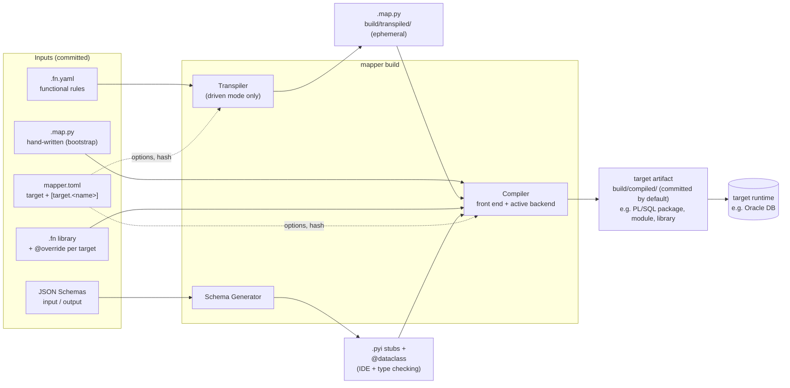
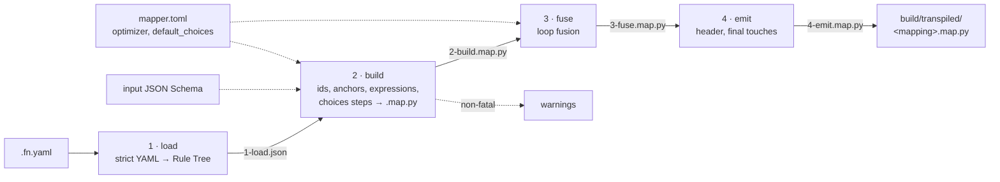
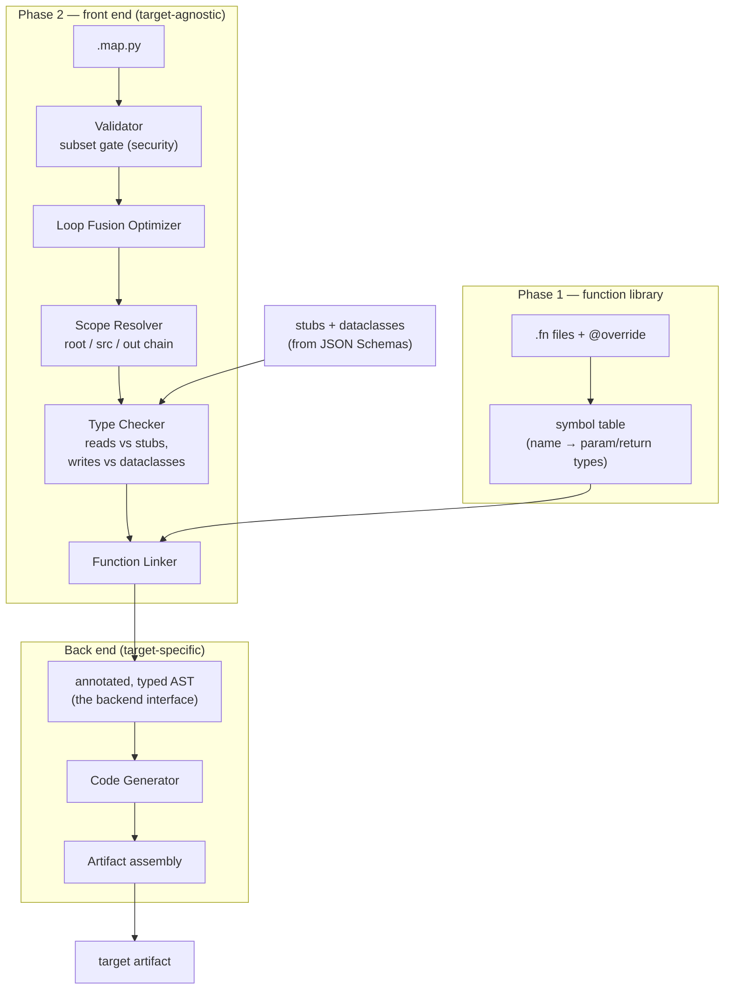
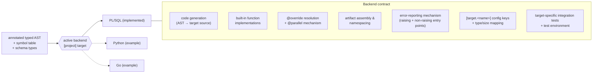
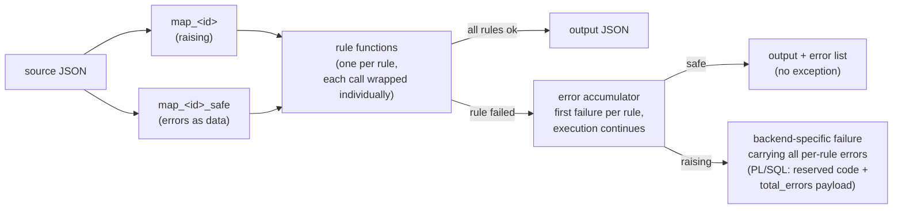
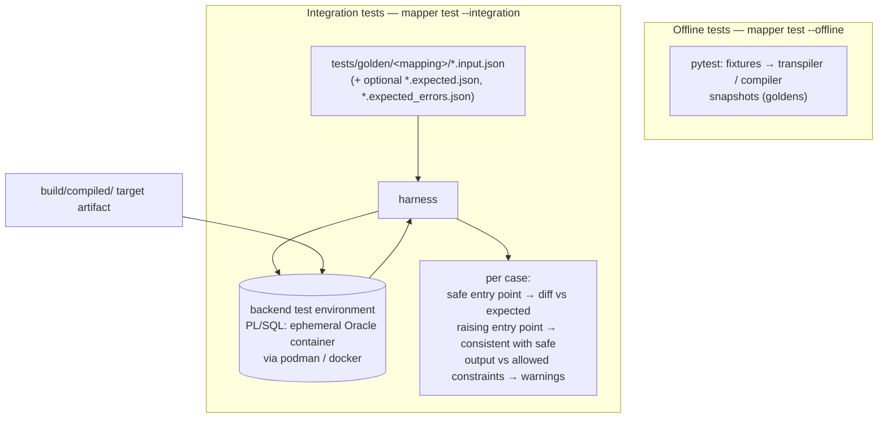
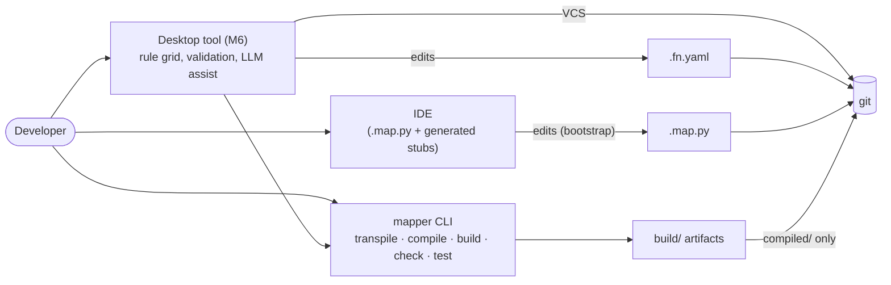

# json2json-mapping-engine — Architecture

> First draft. Based on design discussion; subject to revision.

## Overview

`json2json-mapping-engine` is a **compiled mapping engine** for JSON-to-JSON transformations.
Developers write mapping rules in a restricted, hard-typed subset of Python syntax.
A compiler translates those rules to native code in the target runtime (initially PL/SQL).
There is no DSL interpretation at runtime — the output is ordinary compiled code.

---

## Architecture at a glance

High-level views of the system. Each diagram is detailed in the section named under it;
this chapter is the map, not the specification.

**Target-agnostic by design.** Everything up to and including the compiler's Type
Checker and Function Linker knows nothing about the target language. A *target backend*
(selected by `[project] target` in `mapper.toml`, configured under `[target.<name>]`) is
the only part that emits code. **PL/SQL is the first backend and the reference
implementation, not a premise of the architecture**: in the diagrams below, "target
artifact" and "target runtime" stand for whatever the active backend produces and runs
on, and PL/SQL appears only as an example (§Target backends).

### 1. Sources, build and artifacts

Two ways in (§Operational modes): **bootstrap** — the developer hand-writes `.map.py`;
**driven** — the `.fn.yaml` is the source of truth and the `.map.py` is generated. From
the `.map.py` on, the path is the same.



*Detail: §Compiler pipeline, §Build CLI, §Build folder and incremental compilation.*

### 2. Transpiler: `.fn.yaml` → `.map.py`

Four stages; each can be dumped to `build/transpiled/stages/<mapping>/` and re-run from
that artifact (`--stage`, `--dump-stages`, `--cached`). The output is plain Python subset:
the transpiler is target-independent too.



*Detail: §Transpiler pipeline, §choices.*

### 3. Compiler: `.map.py` → target code

A language-agnostic front end feeds a pluggable back end. Only the Code Generator and
Package Assembly are target-specific.



*Detail: §Compiler pipeline, §Loop Fusion Optimizer.*

### 4. Target backends

What a backend contributes. The engine core discovers the backends under
`compiler.backends`, selects one via `[project] target` and validates its
`[target.<name>]` section against the keys the backend declares. PL/SQL is
implemented today; Python and Go are illustrative (§Target backends).



*Detail: §Compiler components, §Target backends.*

### 5. Generated code at runtime

The contract every backend honours: each mapping yields **two entry points over the same
rule functions** — a *raising* one and a *safe* one that reports failures as data. The
mechanism is the backend's (PL/SQL: `RAISE_APPLICATION_ERROR` with a reserved code and a
JSON payload; a Python target: a `MappingError` exception; Go: a typed `error`).



*Detail: §Generated artifact, §Runtime error semantics.*

### 6. Testing

Offline tests need no runtime at all. Integration tests are specific to each backend and run
in its test environment; the diagram shows the PL/SQL ones (an ephemeral Oracle
container), the only ones implemented so far.



*Detail: §Testing.*

### 7. Tooling around the engine

The desktop tool (M6) edits `.fn.yaml` and drives the same CLI and libraries; it adds no
build logic of its own.



*Detail: §Functional Layer, §IDE setup for `.map.py` development.*

---

## Design principles

- **Python as syntax, not runtime.** The `.map` files are valid Python that is never executed as Python. The Python AST is the compiler frontend.
- **Hard-typed.** Every variable, parameter, and return value carries an explicit type annotation. Untyped code is a compile error.
- **No stdlib, no classes, no imports.** Only Python syntax constructs are allowed. The sole permitted import (`from __mapping__ import ...`) is an IDE stub and is stripped by the compiler.
- **JSON Schema as single source of truth.** Input and output types are derived from JSON Schemas, not hand-written. Dataclasses and stubs are generated artifacts.
- **Zero runtime overhead.** Mapping logic is emitted as native functions in the target language. No JSON parsing of mapping rules at runtime.

---

## Language subset

### Permitted constructs

| Construct | Notes |
|---|---|
| `def` + type annotations | functions only, no methods |
| `@dataclass` | output type definitions only; no methods inside |
| `@decorator` | `@override`, `@parallel`, `@dataclass` |
| `if` / `elif` / `else` | statement and expression form |
| `for x in <expr>:` | iteration over JSON arrays; in the mapping body, or inside a rule function to build a nested output array (§Nested output) |
| `continue` | skip current iteration (→ `CONTINUE WHEN` in PL/SQL) |
| `return` | bare `return` = omit field entirely (no emission) |
| `return Null` | emit field explicitly as JSON null (`"field": null`) |
| `return <expr>` | emit field with value |
| Local variables | `x = <expr>` inside a function or expression block; names are mangled by the compiler to avoid collision with loop variables in the wider scope |
| Operators | `+ - * / // % == != < > <= >= and or not` |
| Literals | `str`, `int`, `float`, `bool`, `None` |
| Attribute access | `root.a.b.c` → JSON path `$srcroot.a.b.c` |
| Type union | `T \| None` for nullable fields; `T \| Null` for explicitly-nullable fields |

### Blocked constructs

`class` (without `@dataclass`), `import` (other than `__mapping__`), `lambda`, `yield`,
`async`/`await`, `*args`, `**kwargs`, `global`, `nonlocal`, `exec`, `eval`,
`try`/`except`, `with`.

Local variable assignments (`x = ...`) are **permitted inside `.fn` function bodies**
and inside multi-line `.fn.yaml` expression blocks, but are **blocked in `.map` file
scope** outside of per-field function bodies. This keeps every field assignment in
`.map` files reducible to a single traceable expression, which is required for
round-trip import and loop fusion analysis. The sole exception is a single reserved
module-level assignment, `__id__ = '<literal>'`, used in bootstrap mode to override the
mapping id (§Operational modes) — the Validator recognizes it as a compiler metadata
directive, not a general-purpose variable.

### Type system

| DSL type | PL/SQL type | JSON Schema type |
|---|---|---|
| `str` | `VARCHAR2(n CHAR)` or `CLOB` — see below | `string` |
| `int` | `NUMBER(38,0)` | `integer` |
| `number` | `NUMBER` | `number` |
| `date` | `DATE` | `string` + `format: date` |
| `datetime` | `TIMESTAMP` | `string` + `format: date-time` |
| `bool` | `BOOLEAN` | `boolean` |
| `T \| None` | nullable equivalent | `null` union or `nullable: true` |
| `Null` | explicit JSON null sentinel (see Return semantics) | `null` |
| `list[T]` | `JSON_ARRAY_T` | `array` |
| `@dataclass` | `JSON_OBJECT_T` | `object` |

**String sizing (PL/SQL backend).** The Schema Generator sizes `str` fields from the
JSON Schema `maxLength`: if `maxLength` is declared and does not exceed 4000, the field
is declared `VARCHAR2(maxLength CHAR)`; if `maxLength` is absent or exceeds 4000, the
field falls back to `CLOB` instead of risking a runtime truncation error against
Oracle's `VARCHAR2` limit. This is a PL/SQL-backend decision, not an engine-level one —
other targets size their own string types according to their own limits.

When a JSON Schema is available, the Schema Generator produces named stubs for every
alternative in `oneOf` / `anyOf` constructs (e.g. `PaymentCard | PaymentBank`) so the
type checker can validate access against the correct shape. `patternProperties` and other
open-ended constructs fall back to `JsonObj` — an opaque type treated as `Any` by the
type checker. Structural validation for `JsonObj` fields is delegated to the post-mapping
JSON Schema validator (out of scope for the engine).

### Return semantics and field emission

Three distinct return forms control how a field is emitted:

| Form | Field in output | JSON value |
|---|---|---|
| `return <expr>` | present | computed value |
| `return Null` | present | `null` |
| `return` (bare) | absent | *(not emitted)* |

`Null` is a DSL keyword, not Python's `None`. The validator treats `return Null` as
a typed sentinel and rejects it if the declared return type does not include `Null`.
A bare `return` is always valid regardless of return type — it signals that this
invocation produces no contribution to the output, equivalent to a field-level skip.

In PL/SQL the Code Generator emits a two-flag guard per field:

```plsql
IF NOT v_ord_lin_skip THEN
    IF v_ord_lin_is_null THEN
        v_out_obj.put('amount', CAST(NULL AS NUMBER));
    ELSE
        v_out_obj.put('amount', v_ord_lin_result);
    END IF;
END IF;
```

---

## Context variables

Inside `.map` files, three magic names are available. They are not Python objects at
runtime — the compiler resolves attribute access on them to JSON path expressions.

| Name | Meaning | Scope |
|---|---|---|
| `root` | Root source document (`$srcroot`). Type derived from the input JSON Schema; `Any` without schema — reads are unchecked. | everywhere |
| `src` | Current loop item. Type derived mechanically from the source path: `$.events[*]` → `Event`, `$.orders[*].items[*]` → `Item`. `Any` without schema — reads are unchecked. | inside `for` body |
| `out` | Current output element being built. Type derived from the output JSON Schema (generated `@dataclass`); assignments are type-checked against the declared fields. Without schema, `out` is an untyped object — writes are accepted as-is with no field or type validation. | inside `for` body or function body |

All three are imported via `from __mapping__ import *`. The `__mapping__` module does
not exist at Python runtime — it is an IDE stub only, generated by `mapper stubs` into
`build/python/stubs/__mapping__.pyi`. In that stub, `root` and `out` are typed against
the project's generated schema stubs and dataclasses; `src` is typed as the top-level
input type (the IDE infers the correct element type inside `for` loops from the
iterator's declared return type).

Inside a `for` loop, `srcroot` can be locally re-bound for path shorthand:

```python
for item in root.source.orders:
    # root is still the document root
    # src aliases item implicitly inside the loop body
    ...
```

---

## Output type contract (`@dataclass`)

Output types are declared with `@dataclass`. The compiler enforces:

1. Every `required` field in the corresponding JSON Schema is assigned before `return`.
2. Assignments to `out.<field>` must match the declared field type.
3. Assignment to an undeclared field is a compile error.

When no output JSON Schema is provided, no `@dataclass` is generated and `out` is an
untyped object. Assignments to `out.<field>` are accepted as-is — the compiler emits
whatever the developer writes without field or type validation. Correctness is
the developer's responsibility and can only be verified against actual runtime output.

```python
@dataclass
class OrderLine:
    order_id: int
    product_code: str
    unit_price: number
    shipped_at: date | None  # optional
```

---

## Input type contract (stubs)

Input schemas generate `.pyi` stub files. The compiler uses them for read-access
type checking only — accessing a non-existent field is a compile error; accessing
a subset of fields is always valid.

When no input JSON Schema is provided, `root` and `src` are `Any`. All field reads
succeed without type checking — the mapping is authored blind, and correctness is
verified only at runtime against actual data.

```
schemas/order_event_input.schema.json   →   generated/stubs/order_event.pyi
schemas/order_line_output.schema.json   →   generated/dataclasses/order_line.py
```

Generated files are checked into the repository and must not be edited manually.
`mapper check` regenerates them from schemas and fails if the checked-in files are out of sync.

### Which schema a mapping uses

By convention `mappings/functional/<name>.fn.yaml` is checked and typed against
`schemas/<name>_input.schema.json` and `schemas/<name>_output.schema.json`; each is optional.
A project that keeps its schemas elsewhere says so in the file's header, with paths from the
project root; the override wins over the convention, per schema:

```yaml
schemas:
  input: contracts/order-v2.json
  output: contracts/summary.json
```

The schemas in the header are read for the check, the types and the build cache key (a change
to the file rebuilds the mapping). The tool never executes anything from them.

### Rules not defined yet

A rule with no Source and no Expression (and no override), a loop with no Source, or a
container whose rules are all of that kind, is *unfinished*: the file loads, the tool draws it
apart, the check says "ignored until a Source is defined", and the transpiler builds nothing for
it. When the output schema lists the field as `required`, it is an error and `mapper build`
stops. They are what the tool creates from an output schema before the user fills them in.

### Schema change management

When an input JSON Schema changes, the compiler regenerates the affected `.pyi` stubs
and compares them against the checked-in versions. If any `.fn.yaml` rule references a
path that no longer exists or has a changed type, the build **fails hard** — there is no
auto-approval path. The developer must explicitly review the affected rules, update any
`code_override` or `expression` fields that are now invalid, and re-commit before the
build is unblocked.

The tool flags affected rows in the grid with a schema-conflict indicator so the
developer can filter and resolve them before pushing. Silent schema drift is not
permitted.

Loading a schema in the tool (input or output) also acts on validation: a **validated** rule that
the new schema invalidates, that is, a rule with an error against the new schemas that it did not
have against the old ones (its Source path is gone or has another type, or its Target field is gone
or has another type), goes back to review (`validated: false, needs_review: true`) with a note that
says what the schema did (`transpiler/schema_decay.py`, op `schema_import`). The tool says how many
went back. A rule already in review or never validated, and a rule the schema does not touch, stays
as it is. The change is in the open tree, unsaved, like any edit.

---

## Function library

### Built-in functions

A set of primitive functions is hardcoded in the tool and available in every project
without any configuration. Each built-in has an implementation for every supported
target language via `@override` declarations. Examples: `coalesce`, `round`, `concat`,
`if_else`, `split_first`, `split_nth`, `lookup`, `parse_date`.

**Text, conversions, timestamps.** `replace(s, search [, replacement])` and
`remove_prefix(s, prefix)` (a null text gives a null result); `regexp_replace(s, pattern [, replacement])`
and `regexp_group(s, pattern, n)` (null when there is no match or no such group); `format_decimal(x, n)`
(rounded half away from zero, all `n` decimals written: `"2.50"`); `to_number(x)` (a text must be a plain decimal:
sign, digits, a fraction after a dot, spaces around it ignored, up to 20 digits before the dot and 18
after; an exponent, thousands separators, a decimal comma or any other text is an error, an empty text
is null) and `to_string(x)` (no exponent, whole numbers
without decimals); `to_utc(s)` and `rfc3339_normalize(s)` read an ISO-8601 or RFC3339 timestamp (no
time is midnight, no offset is UTC, the fraction of a second is kept as written) and write it in UTC
(`2026-10-03T07:30:00Z`), or with its offset kept (`2026-10-03T09:30:00+02:00`). `round(x)` without
digits rounds to a whole number.

`is_empty(x [, zero_is_empty])` is true when `x` (a field or any expression) is missing, null or an empty text, and, with `zero_is_empty`, a number that is 0 (by default 0 is a valid number). A boolean, a list and an object are never empty (`count` tells whether a list has elements). Use it instead of comparing with `''`.

**Empty text.** An empty text is null, as in Oracle, which cannot tell them apart: the language
follows it, so that every backend gives the same results. An empty text in the input is read as
null; a built-in whose result would be empty (`split_first`, `split_nth` on an empty part,
`replace` that removes everything, `concat` of nothing, `lookup`, `regexp_*`, `remove_prefix`,
`to_string`) gives null; the output never holds an empty text. `split_nth("a|b||||f|", "|", n)` is
`a`, `b`, null, null, null, `f`, null for 1 to 7, and null beyond the end or for `n < 1`; a null
text gives null in every text function. Golden mapping: `empty_text`.

**Regular expressions are the one place where backends are not interchangeable.** The pattern of
`regexp_replace` and `regexp_group` is written in the dialect of the backend that runs the mapping
(Python's `re` for the Python backend, Oracle's `REGEXP_*` for PL/SQL); the tool does not translate
between them. Keeping to what the chosen target accepts, and to the common part of the dialects when
a project may change backend, is the project's responsibility. This is a documented exception to the
rule that the same input gives the same output whichever backend compiled the mapping.

**Aggregation** — `max`, `min`, `sum`, `avg`, `count` reduce an array to a scalar:
`max($.myList.numAttr)` (`$.myList[]`/`$.myList[*]` are accepted as equivalent, more
explicit spellings of the same thing). Unlike the built-ins above, these have no
single-expression target rendering — computing an aggregate requires iterating the
array, so the PL/SQL backend lowers a call to one of these into a native loop with an
accumulator (no SQL-context detour: `max`/`min` compare via `JSON_ELEMENT_T.compare_to()`,
type-agnostic across numbers/strings/dates; `sum`/`avg` accumulate as `NUMBER`
directly). Because of this, a call to one of these can only appear as the direct value
of a `return`, an `out.<field> = ...` assignment, or an `.append(...)` argument — not
nested inside a larger expression. In the Python subset the array/field arguments are
positional: `max(<array>, "<field name>")`.

**The registry.** The built-ins are declared once, as typed Python with docstrings, in
`compiler/builtins.py`; the project's `fn/*.fn` files are read the same way (with `ast`:
project code is never executed by the tool), and a project function replaces a built-in of the
same name. `compiler/function_registry.py` reads names, parameters, annotations, docstrings
and decorators. Everything else derives from it: the type checker's signatures
(`transpiler/exprtypes.py`; a function marked `@special` has a type that depends on its
arguments and is typed by hand), the completion of the desktop tool (signature, description and
origin), and the `def` stubs that `mapper stubs` adds to `__mapping__.pyi` for the IDE. A
conformance test compiles a call to every registered function with each backend, so a
function that is declared but not implemented fails the build of the tool, not of a project.

The built-in library is versioned with the tool using **SemVer**:
- **MAJOR** — signature change (breaking); `.fn.yaml` files referencing the changed
  function must be updated explicitly before the build succeeds.
- **MINOR** — new built-in functions added; existing `.fn.yaml` files unaffected.
- **PATCH** — bug fix in a target implementation; no interface change.

Supporting a new target language requires adding an `@override(target=...)` for every
built-in function. To facilitate this, the tool ships reference `.fn` files (the same
source the built-ins are compiled from) as open-source material that teams can copy,
read, and adapt.

### Truthiness

A condition is true or false the way it is in Python. **False:** a missing value, `null`,
`false`, `0` / `0.0`, `""`, `[]` and `{}`. **True:** everything else, so `"0"`, `" "` and
`[0]` are true. This holds wherever a condition is expected: an `object`'s `guard`, a
loop's `filter`, `if`, `if_else`'s first argument, `x if c else y`, and `and` / `or` /
`not`. `if $.customer` is therefore shorthand for "`customer` is present and not empty"
(with `0` and `false` counting as *absent*: to test presence only, compare with `None`).

This is a language rule, not a backend's: every backend must give the same answer, and
the `truthiness` golden cases pin it down value by value. The PL/SQL backend has no
truthiness of its own, so it lowers a condition by what it tests: comparisons and boolean
operators stay as they are, a value read from the source document goes to the shared
`truthy` function (which inspects the JSON element at runtime), and a typed local is
tested by its type (`IS NOT NULL` for text, `<> 0` for numbers, `get_size > 0` for
collections). Because the check does not expect a particular type of a condition, a
`guard` or `filter` accepts any value; only what is *inside* it is type-checked.

### Project functions and overrides

Custom functions and built-in overrides are declared in `.fn` files placed in the
project's `fn/` folder, using the same restricted Python subset.
They operate only on typed scalar parameters — no access to `root`, `src`, or `out`.

```python
# fn/string_fns.fn
from __mapping__ import override


@override(plsql="REGEXP_SUBSTR({s}, '[^ ]+', 1, {n})")
def split_part(s: str, n: int) -> str | None:
    parts = s.split()
    return parts[n - 1] if n <= len(parts) else None
```

**Resolution priority (per function name, per target):**
1. Project `fn/` file with `@override(target=...)` for the current target → use verbatim
2. Project `fn/` file with a DSL body → compile through pipeline
3. Built-in hardcoded implementation for the current target → use verbatim
4. None of the above → **compile error**: no implementation for this target

A project function with the same name as a built-in overrides it entirely for that
target. This allows a team to replace a built-in implementation without forking the tool.

If a function is used in a `.fn.yaml` but has no valid implementation for the current
compilation target, the build fails immediately with a clear error identifying the
function and the missing target.

The Python body in a `.fn` file is the only part of the system that is also executable
as real Python. It serves as the reference implementation and can be tested with standard
Python tooling without any target-runtime dependency.

Functions are compiled to the `MAPPING_FUNCTIONS` package (PL/SQL target).
The compiler resolves function signatures from all `.fn` files before compiling `.map`
files (Phase 1). The transpiler uses the same symbol table: project `fn/` files are
loaded with the same precedence rules before expression translation begins.

---

## Decorators

### `@override(target="...")`

Provides a target-language verbatim implementation for a function.
Placeholders `{param_name}` are substituted with the compiled argument expressions.

```python
@override(plsql="TO_DATE({s}, {fmt})")
def parse_date(s: str, fmt: str) -> date: ...
```

### `@parallel(degree=N)`

Declares that a mapping function should execute with parallel degree `N`.
The backend decides the mechanism:

| Target | Mechanism |
|---|---|
| PL/SQL | Scalar wrapper `map_<id>_fn(p_src CLOB) RETURN CLOB PARALLEL_ENABLE`, generated for every mapping with at least one `@parallel` rule function |
| Python | The elements of a loop whose body only appends values (some under an `if`) and calls a `@parallel` rule, fused loops included, are mapped by up to N threads (`[target.python] parallel = "thread"`, a speed-up on a free-threaded Python) or N worker processes (`"process"`: the workers are kept between loops and load the module by its file; the caller's entry point must be under `if __name__ == "__main__":`; when the elements cannot travel, the loop runs here with the same result). Loops inside loops go parallel too, within one total: `[target.python] max_parallel` (default 4, 1 or more; 1 turns `@parallel` off) is the most workers all the loops of a mapping have at once. A loop takes what is free of the degree it declares (two at least, else it runs in order) and gives it back; it never waits, so nested loops cannot lock each other, and a loop inside a worker process runs in order. Results and errors equal the sequential run's: element order, the first failure of a rule wins |

`PARALLEL_ENABLE` only applies to a function called from a SQL statement: Oracle may then
run it in parallel-query slaves, one document per call. It cannot parallelize a PL/SQL
loop, and the `map_<id>` procedures are not SQL-callable (`OUT` parameters), hence the
wrapper. It calls the raising twin `map_<id>`; the caller picks the degree, e.g.
`SELECT /*+ PARALLEL(4) */ pkg.map_x_fn(doc) FROM staging`, and the generated comment
lists the declared degrees. Intra-document parallelism (a pipelined table function over
`JSON_TABLE`) and `DBMS_PARALLEL_EXECUTE` (chunked jobs over a staging table) were
considered and not implemented.

The mapping file declares intent; the backend emits the appropriate scaffolding.
`@parallel(4)` is an alias of `@parallel(degree=4)`.

In a `.fn.yaml` the decorator comes from a loop key, `parallel: 4` or
`parallel: {degree: 4}` (integer >= 1; loops only, at any nesting depth). The transpiler
always emits the explicit `@parallel(degree=4)` on the loop's element function.

**Conflict with Loop Fusion.** When the Loop Fusion Optimizer merges several field
functions that iterate the same source array into a single generated loop, their
`@parallel` declarations must agree. By default, any mismatch (different `degree`
values, or some functions declaring `@parallel` and others not) is a **compile error**
naming the conflicting functions. A project may relax this in `mapper.toml`:

```toml
[optimizer]
parallel_conflict = "exception"   # exception (default) | max | min
```

`"max"` / `"min"` resolve the conflict automatically by taking the highest or lowest
declared degree among the fused functions instead of failing the build.

---

## Compiler pipeline

```
Phase 1 — Function library
  Input:  .fn files + @override annotations
  Steps:  parse Python AST → validate subset → type-check →
          resolve overrides per target → emit MAPPING_FUNCTIONS package
  Output: symbol table (function name → param types, return type)

Phase 2 — Mapping rules
  Input:  .map files + generated stubs + generated dataclasses + symbol table
  Steps:  parse Python AST → validate subset → scope resolution →
          type-check (reads vs. stubs, writes vs. dataclasses) →
          emit one package per mapping
  Output: one procedure per mapping function
          signature: map_<id>(p_src IN CLOB, p_out OUT CLOB)
```

### Compiler components

| Component | Responsibility |
|---|---|
| **Validator** (`ast.NodeVisitor`) | Block forbidden Python constructs and imports. **Security gate**: in bootstrap mode, `.map.py` files are hand-written and enter the build as-is — the Validator is the sole barrier against arbitrary Python execution. It must run before any other compiler phase and must reject any construct outside the permitted subset, regardless of source. This prevents code injection via crafted `.map.py` files. |
| **Scope Resolver** | Build `root` / `src` / `out` context chain per nested loop |
| **Type Checker** | Annotated AST: validate reads against stubs, writes against dataclasses |
| **Function Linker** | Resolve custom function calls to signatures from Phase 1 symbol table |
| **Loop Fusion Optimizer** | Build dependency DAG across all field functions; collapse loops over the same source array; topologically sort to resolve accumulation ordering |
| **Code Generator** | Annotated AST → target language source (one backend per target) |
| **Schema Generator** | JSON Schema → `.pyi` stubs and `@dataclass` files; named stubs for `oneOf`/`anyOf` alternatives when schema is available; `JsonObj` fallback for open-ended constructs |

The Code Generator is the only target-specific component. All phases before it are
language-agnostic and reusable across backends.

### Loop Fusion Optimizer

The optimizer operates on the full set of field functions after type-checking, before
code generation. It builds a directed acyclic graph (DAG) where:

- Each node is a field function with its source scope (which array it iterates over).
- Each edge represents a data dependency: field B reads a value produced by field A
  (e.g. an accumulation over an inner array consumed in the outer loop).

From the DAG the optimizer derives the minimum set of loops and their emission order:

```
Fields on $.orders[*]:        A, B, C  → fused into 1 loop
Fields on $.orders[*].items[*]: D, E   → nested loop inside the above
Field F on $.orders[*] depends on sum(D) → D's loop is emitted first as a pre-pass
```

The optimizer emits loop groups to the Code Generator in topological order.
Cycles in the DAG (circular dependencies between fields) are a compile error. Before
emitting a fused loop group, the optimizer also checks that every function in the group
agrees on `@parallel` (§`@parallel(degree=N)`) — resolved per `optimizer.parallel_conflict`.

Differing `filter` expressions (§Loop rule) across the `loop` rules being fused are
*not* a conflict — the optimizer iterates the unfiltered source array once and
rewrites each original `loop` rule's `filter` into a per-branch `IF` guard around
that rule's contribution (its output-array append and everything nested under it).
Because each branch is independently guarded by its own original filter, this holds
regardless of how the filters relate to each other (identical, disjoint, or
overlapping) — there is no equivalent of `optimizer.parallel_conflict` for filters,
since this rewrite is always correct and needs no configuration.

---

## Target backends

The engine core is target-agnostic; a **backend** is what makes it emit code for a
particular language and runtime. The active one is `[project] target` in `mapper.toml`;
its configuration lives in `[target.<name>]`, and the loader validates that section
against the keys the backend requires (`Backend.required_keys`). The PL/SQL backend is
described in [backends/plsql.md](backends/plsql.md).

**The interface is coarse on purpose** (`compiler/backends/base.py`). A backend
receives one checked, annotated mapping and returns a `CompiledUnit`; later it
assembles all the units of the project into the deployable artifact. How it emits code
inside a unit is its own business — targets differ too much for a shared line-level
contract to stay honest.

```python
class Backend(ABC):
    target: ClassVar[str]                 # "plsql" for PlsqlBackend
    required_keys: ClassVar[tuple[str, ...]]   # [target.<name>] keys it needs
    defaults: ClassVar[dict[str, Any]]         # ... and their defaults
    options: ClassVar[tuple[Option, ...]]      # every key it reads: kind, help, choices
    def compile_module(tree, mapping_id, scope_resolution) -> CompiledUnit
    def unit_from_json(data) -> CompiledUnit   # build-cache entries
    def assemble(units) -> str                 # the artifact text
    def artifact_path(compiled_dir) -> Path    # where it is written
```

A backend contributes:

| Concern | What the backend decides |
|---|---|
| Code generation | Annotated AST → target source for one mapping: type and string-size mapping, per-rule call site with error accumulation, loops, the twin entry points |
| Built-ins | Native implementation of each built-in function (§Built-in functions); the backend hands them to the target-agnostic Function Linker |
| `@override` / `@parallel` | Resolution of `@override(target=...)` and the parallelism mechanism (§Decorators) |
| Assembly and namespacing | How the units of a project become the deployable artifact (PL/SQL: one package per mapping, `<package>.sql` each; others may use a module or namespace per mapping) |
| Error reporting | The failure mechanism behind the raising entry point (§Runtime error semantics, *Other targets*) |
| Configuration | Its `[target.<name>]` section: `options` lists every key with its kind (`string`, `int`, `bool`, `choice`, `table`), help text, default and valid values (and, for an `int` or a `string`, limits: `minimum` / `maximum`, `min_length` / `max_length`, a `pattern` with a `pattern_hint` in words, `choices`; `suggest` is what a new project proposes for a key it cannot default); the loader rejects unknown keys and wrong kinds, and `validate_config` keeps the rules that span keys. The desktop tool draws the project-properties form from `options`, so a backend that declares them gets its form for free |
| Integration tests | Its own golden-case tests and test environment (image or runner), §Testing |

How to write one, step by step: [docs/backends/writing-a-backend.md](backends/writing-a-backend.md).

**Backends are interchangeable.** For the same mapping and input, every backend must
produce the same output and report the same rule errors; the golden cases are the shared
contract and every backend runs all of them. A behaviour that differs between targets
(rounding, null vs. empty string, date parsing, division by zero) is a bug in one of the
backends or an undecided semantic, to be settled in the language, not per target.

**Discovery.** The registry (`compiler/backends/registry.py`) is self-maintaining: it
imports every module under `compiler.backends` and registers each concrete `Backend`
subclass under its `target` attribute. Adding a target means adding a subpackage
(`compiler/backends/go/`) with a `Backend` subclass that sets `target = "go"`; nothing is
registered by hand. A project can add its own backends, or **override** a built-in one,
with a `compiler/backends/` folder in the project root, discovered the same way; a
project backend whose `target` equals a built-in's replaces it (project code, run at
build time like any build script). Two backends of the same origin claiming one name, or a
config naming an unknown target, are errors that list what is available. The build (`cli/build.py`) and the
pipeline only talk to the `Backend` interface, selected by `[project] target`.

**Integration tests are per target.** Each backend brings its own integration tests and
test environment (PL/SQL: golden cases against an ephemeral Oracle container). The part
every target shares (finding the golden cases, judging the output, the `allowed` warnings) is
`cli/track2.py` and `compiler/backends/integration.py`; how a case is *run* is the backend's
(`Backend.integration_unavailable` / `run_integration`; PL/SQL:
`compiler/backends/plsql/integration.py`). What the tests need is the backend's too, in
`[target.<name>.test]`, declared by `Backend.test_options` (PL/SQL: `container_image`,
`container_tag`): a target that runs in-process has none and needs no container. The old global
`[test]` table is refused, with a message pointing to the new one.

## Generated artifact (PL/SQL)

Each mapping compiles to a stored procedure in its own package, named after
the mapping's id (§Rule id generation):

```plsql
PROCEDURE map_order_event_48 (
    p_src IN  CLOB,
    p_out OUT CLOB
) AS
    v_srcroot  JSON_OBJECT_T := JSON_OBJECT_T(p_src);
    v_out_obj  JSON_OBJECT_T := JSON_OBJECT_T();
    -- local variable declarations
BEGIN
    -- loop and assignment blocks
    p_out := v_out_obj.TO_CLOB();
END;
```

The mapping engine calls `<package>.map_<id>(p_src, p_out)` — no DSL
interpretation, no JSON rule parsing at runtime. Every mapping additionally compiles a
twin procedure, `map_<id>_safe`, with different failure behaviour — see §Runtime error
semantics.

**Namespacing.** Rule ids are unique only *within* a mapping, so two mappings may
both define a rule called `order_id`. For PL/SQL each mapping is its own package: it holds
`map_<id>`, `map_<id>_safe` (and `map_<id>_fn` for `@parallel`) and the mapping's rule
functions, still named `fn_<mapping_id>_<rule_id>`. The package name is chosen in
`mapper.toml`, in exactly one of two ways (neither, or both, is an error):

```toml
[target.plsql.mapping_packages]      # explicit
orders = "ORDERS_PKG"

# or generated: <prefix><MAPPING ID><suffix>, upper-cased
mapping_package_prefix = "J2JME_MAP_"
mapping_package_suffix = "_PKG"      # either or both
```

An optional `mapping_index_package = "J2JME_MAPPINGS"` adds one more package that only
forwards every entry point (same signatures) to the mapping's package, so callers always use
one name. The output is one file per package in `build/compiled/` (lowercase package name);
deploy order is the functions package (below), the mapping packages, then the index. Consequences: mapping ids must be
unique project-wide (a duplicate is a build error); two mappings cannot share a package;
changing a mapping recompiles only its own package (the index depends on specs, which a
body change does not touch); generated identifiers must fit Oracle's 128-byte limit
(checked at compile time). Other backends may choose differently (e.g. a module or
namespace per mapping).

**Functions package.** Built-ins with no 1:1 PL/SQL equivalent (`split_first`, `split_nth`,
`lookup`) are functions of a shared package, `functions_package` (default `J2JME_FUNCTIONS`),
called by every mapping instead of being inlined. It is generated only when a mapping uses
one of them and deployed first. Details: [backends/plsql.md](backends/plsql.md).

**Rule-function visibility.** Every `.map` rule function (one per field/array-element
rule, §Compiler pipeline) is compiled into the package body alongside `map_<id>` /
`map_<id>_safe`. By default only the two entry-point procedures appear in the package
**spec** — every `fn_<mapping_id>_<rule_id>` is package-private, callable from other code in the same
package body but not from outside it. Setting

```toml
[target.plsql]
export_rule_functions = true   # default: false
```

additionally lists every `fn_<mapping_id>_<rule_id>` in the package spec, making each rule function
independently callable — e.g. for external reuse or for unit-testing an individual
rule's logic in isolation from the full mapping. This is a package-assembly-time
decision (which names go in the spec), not a code-generation-time one: the rule
functions themselves are generated identically either way.

`schema` qualifies the created packages, and `fn_prefix` / `fn_suffix` decorate entry
points and rule functions. Details: [backends/plsql.md](backends/plsql.md).

---

## Runtime error semantics

**Null is a value, never a side effect of failure.** Every place a field can carry "no
value" is an explicit, typed branch: a function signature declaring `T | None`, handled
by `coalesce` / `if_else` / an explicit guard, resolving to `return Null` or a bare
`return` (§Return semantics and field emission). A function whose signature does not
include `None` is asserting that it always produces a `T` for any input satisfying its
parameter types — built-ins and project `.fn` functions that can fail to produce a
value are expected to encode that as `T | None` and guard for it in their body (as in
the `split_part` example), not let it surface as an uncaught error. Anything that still
fails at runtime — an arithmetic error, a type coercion mismatch on unchecked `Any` data
reached via `root`/`src` with no schema, a target-language `@override` that misbehaves
relative to its Python reference — is therefore never ambiguous with a null: by
construction it is an unhandled fault, and it raises.

**Per-rule wrapping, not per-expression.** The Code Generator wraps each rule-function
call site inside the mapping's procedure individually — one rule = one function, per
the project's convention — not every nested call inside a rule's expression tree. A
failure several calls deep inside a rule's expression is still attributed to that rule
as a whole; the original error message is preserved as the failure's cause.

**Errors accumulate instead of failing fast.** A single failing rule does not abort the
mapping immediately. The generated procedure keeps an in-memory accumulator keyed by
the rule's fully-qualified id (§Rule id generation): the *first* failure for a given
rule is recorded, subsequent failures for the same rule (e.g. repeated iterations of the
same loop) are ignored, and execution continues with the remaining rules. A single
invocation therefore surfaces every distinct failing rule in one pass instead of one
rebuild-fix-rebuild cycle per error — relevant for mappings with 300+ rules.

```plsql
BEGIN
  v_out.LineAmount := fn_ord_lin(...);
EXCEPTION WHEN OTHERS THEN
  IF NOT v_errors.EXISTS('ord.lin') THEN
    v_errors('ord.lin') := SQLERRM;
  END IF;
  -- no RAISE here — continue with the next rule
END;
```

**Twin procedures, always generated, no configuration.** Every mapping compiles to two
procedures sharing the same core logic:

| Procedure | On accumulated errors | Signature |
|---|---|---|
| `map_<id>` | raises | `(p_src IN CLOB, p_out OUT CLOB)` |
| `map_<id>_safe` | never raises | `(p_src IN CLOB, p_out OUT CLOB, p_err OUT CLOB)` |

`map_<id>_safe` returns whatever fields were successfully computed in `p_out` (failed
fields are simply left unassigned, same as any other skipped field) alongside `p_err` —
an empty JSON array on success. `map_<id>` raises once, at the end, only if the
accumulator is non-empty; a caller relying on it never receives a partial `p_out`
(PL/SQL does not copy `OUT` parameters back to the caller when a procedure exits via an
unhandled exception). Callers choose per call site which contract they want — this is
not a build-time toggle.

**Error payload.** On raise, `map_<id>` calls `RAISE_APPLICATION_ERROR` with a single
reserved error code (`mapper.toml`, `[target.plsql] error_code`, default `-20000`) and a
JSON payload as the message, truncated to whichever limit is hit first: 20 entries, or
the byte budget left under Oracle's ~2048-byte message limit. The truncation is
self-describing, not silent:

```json
{
  "mapping": "order_event_48",
  "total_errors": 47,
  "shown": 20,
  "errors": [
    {"rule": "ord.lin", "cause": "ORA-01858: ..."}
  ]
}
```

**The Python target** (`compiler/backends/python/`) raises `MappingError`, as below, from `map_<id>`,
and its `map_<id>_safe` gives `(output, rule errors)`; see the Python backend in the implementation plan
for the run-time rules it keeps. The generated modules need **Python 3.10 or later** (the program that
calls them chooses its interpreter: nothing in `mapper.toml` does, and the runtime refuses an older one
when it is imported); `3.14t`, the free-threaded build, is what makes `parallel = "thread"` faster.

**Other targets.** The PL/SQL strategy above (reserved code + JSON payload) is specific
to that backend. A Python target would instead raise a dedicated `MappingError`
exception carrying `mapping_id` and the accumulated per-rule causes (chained via
`raise ... from`); a Go target would return a typed `error`. Per-rule wrapping,
accumulation, and the twin-procedure contract are part of the engine's behaviour; the
*representation* of the error is, like code generation itself, target-specific.

---

## Repository layout (proposed)

```
json2json-mapper/
├── compiler/              ← compiler source (Python)
│   ├── validator.py
│   ├── scope_resolver.py
│   ├── type_checker.py
│   ├── function_linker.py
│   ├── schema_generator.py
│   └── backends/
│       └── plsql/
│           ├── codegen.py
│           └── builtins.py    ← hardcoded built-in function implementations
├── transpiler/            ← transpiler source (Python, 4-stage pipeline)
│   ├── model.py           ← stage load: .fn.yaml → Rule Tree
│   ├── ids.py, anchors.py, expr.py  ← used by stage build
│   ├── transpile.py       ← stages build / fuse / emit
│   └── stages.py          ← stage artifacts (--stage, --dump-stages, --cached)
├── runtime/               ← static IDE stubs (non-generated)
│   └── __mapping__.pyi    ← placeholder; real stub is generated into build/python/stubs/
├── schemas/               ← JSON Schemas (source of truth), flat, one pair per mapping:
│                            <name>_input.schema.json, <name>_output.schema.json
├── generated/             ← checked-in, never edited manually
│   ├── stubs/             ← .pyi files from input schemas
│   └── dataclasses/       ← .py @dataclass files from output schemas
├── fn/                    ← project .fn files (overrides + custom functions)
├── mappings/              ← .map.py files (hand-written, bootstrap mode only)
├── mapper.toml            ← project configuration (see §Project configuration)
└── docs/
    └── ARCHITECTURE.md
```

---

## Project configuration (`mapper.toml`)

All project-level settings live in `mapper.toml` at the repository root.

```toml
[project]
mode   = "driven"    # driven | bootstrap
target = "plsql"     # compilation target
engine = "0.5.0"     # the tool version that last opened the project (see below); written by the tool

[optimizer]
loop_fusion       = true          # disable if side-effects are suspected
parallel_conflict = "exception"   # exception (default) | max | min — see §@parallel(degree=N)

[target.plsql]
schema     = "MAPPING_OWNER"   # Oracle schema that owns the generated packages
mapping_package_prefix = "J2JME_MAP_"   # one package per mapping (or a [target.plsql.mapping_packages] table)
mapping_index_package  = "J2JME_MAPPINGS"   # optional: a package forwarding to all of them
fn_prefix  = ""                # optional prefix for generated entry points and rule functions
fn_suffix  = ""                # optional suffix
error_code = -20000             # reserved RAISE_APPLICATION_ERROR code — see §Runtime error semantics
export_rule_functions = false  # true = list every fn_<rule_id> in the package spec too — see §Generated artifact

[compiler.default_choices]   # per-rule `choices` in the .fn.yaml override these
format     = "round"         # round | truncate (default: round) — `format` decimals
multipleOf = "round"         # round | truncate (default: round) — `allowed.multipleOf` snapping

[publish]                    # optional — where `mapper publish` writes the generated files
dir = "deploy/sql"           # relative to the project, or absolute; default: build/compiled

[target.plsql.test]            # what this target's integration tests need (PL/SQL: a container)
container_image = "container-registry.example.com/oracle-db"
container_tag   = "19.3.0-ee"
```

Each target language defines its own set of required and optional keys under
`[target.<name>]`. A key that is required by the target but absent from `mapper.toml`
is a build error.

### Engine version of a project

`[project] engine` is the version of the tool (engine) that last opened the project, `X.Y.Z` or
`X.Y.Z-suffix`, ordered as semver orders it (a pre-release is older than its release). It is the
only place the version is recorded (not in `manifest.json`), it is written by the tool and not
by hand, and it is not a field of the project-properties form (a form save keeps what is there).
A new project gets the creating tool's version.

| The tool is… | In the desktop tool | `mapper …` |
|---|---|---|
| the same | opens | runs |
| **newer** than the project (or the project has none) | warns that the project will be updated to the tool's version, and on *Open and update* writes it into `mapper.toml`; the tutorial's throwaway copy is updated without asking | runs with a warning; `mapper upgrade` records the version, nothing else does |
| **older** than the project | warns and does not open it, unless the user ticks *I understand the risk of incompatibility*; `mapper.toml` is not changed | refuses (`error: …`), unless `--allow-older-engine` (or `J2JME_ALLOW_OLDER_ENGINE=1`), which runs with a warning |

`mapper.toml` is only ever moved forward: an older tool never writes its version over a newer one
(`mapper upgrade` refuses), whatever the user accepted. Because `mapper.toml` is one of the
sources hashed in `manifest.json`, an upgrade shows in the manifest as a changed source, and with
the artifacts committed `mapper check` asks for a `mapper build` (§Build folder). CI installs the
engine this key names (`packaging/install-mapper.sh`, docs/CI.md), so what it regenerates is
comparable with what was committed. The worker answers `engine_status` and `engine_upgrade` for
the tool (`cli/engine_version.py`).

---

## Build CLI

The `mapper` command is the single entry point for all build operations.

```sh
# Full build: transpile (if driven) + compile → build/
mapper build

# Transpile only: .fn.yaml → build/transpiled/*.map.py  (driven mode only)
mapper transpile
mapper transpile --dump-stages               # also write the 4 stage artifacts
mapper transpile --stage fuse                # stop after a stage (1-4 or load|build|fuse|emit)
mapper transpile --stage emit --cached       # resume from build/transpiled/stages/<m>/<N-1>-*

# Compile only: .map.py → build/compiled/*.sql
mapper compile

# Verify build/compiled/ is in sync with current sources
# driven mode: re-transpiles .fn.yaml → .map.py, recompiles, diffs against committed .sql
# bootstrap mode: recompiles .map.py directly, diffs against committed .sql
# Writes to build/ only; never modifies sources or committed files.
# With the artifacts git-ignored there is nothing to diff: it only builds.
mapper check

# Commit the generated files (build/compiled), or leave them to CI: .gitignore + the git index
mapper artifacts status | ignore | track

# Record this tool's version as the project's engine ([project] engine in mapper.toml), when it
# is newer than the one there. Never lowers it.
mapper upgrade

# Work on a project whose mapper.toml names a newer engine than this tool (otherwise refused):
mapper --allow-older-engine build           # env J2JME_ALLOW_OLDER_ENGINE=1; mapper.toml is not changed

# Publish: check, build, then write the generated files and manifest.json to the publish
# directory; nothing is published if either fails. The check is `mapper check`: with the artifacts
# committed they must match the sources, so what is published is what is in git (--no-check skips
# it; with the artifacts git-ignored there is nothing to compare). Which directory: --to, else
# $J2JME_PUBLISH_DIR (a per-user choice; the desktop tool keeps its own per project, in its
# config folder, and passes it as --to), else `[publish] dir` of mapper.toml (relative to the
# project, or absolute), else build/compiled, where the build already put them. The folder is
# never emptied or replaced (it may be a guest project's, or a synced library): each file is
# written whole (temporary file + rename) and read back against its hash, the old manifest is
# removed first and the new one written last, and only files the old manifest listed and the new
# one does not are removed.
mapper publish [--to DIR] [--no-check]

# Verify a published folder, for whoever reads it before deploying it: every file its
# manifest.json lists is there and has the hash listed; no manifest = unfinished. Needs no
# project when the folder is given (else it is the project's publish directory). Exit 1 on a problem.
mapper verify [DIR]

# Run tests
mapper test --offline          # offline tests, = --track 1 (no runtime needed)
mapper test --integration      # integration tests, = --track 2 (golden records; container runtime)
mapper test                    # both tracks

# Single file
mapper build mappings/functional/order_event.fn.yaml

# Git merge driver for *.fn.yaml (rule-level merge, §The merge engine)
mapper merge-driver-install     # once per clone: git config + .gitattributes (*.fn.yaml, *.fn)
mapper merge-driver %O %A %B %P # what git runs; exit 1 = conflicts left in the file
```

In `bootstrap` mode, `mapper build` skips the transpiler and runs the compiler
directly on the hand-written `.map.py` files in `mappings/`. In `driven` mode,
`mapper build` always re-transpiles before compiling; the `.map.py` files in
`build/transpiled/` are ephemeral and not committed.

How and when to invoke these commands is the responsibility of each project's own
build or deployment workflow. The tool provides no pre-configured pipeline templates.

---

## IDE setup for `.map.py` development

Relevant primarily in `bootstrap` mode, where developers write `.map.py` files by
hand. In `driven` mode the files are ephemeral and not opened in an IDE.

### Generated `__mapping__` stub

`mapper stubs` (also run as part of `mapper build`) generates
`build/python/stubs/__mapping__.pyi` containing:

```python
# generated — do not edit manually
from generated.stubs.order_event import OrderEvent
from generated.dataclasses.order_line import OrderLine
from typing import Any

root: OrderEvent  # typed from input schema; Any without schema (reads unchecked)
src: Order  # element type derived from source path ($.events[*] → Event);
# Any without schema (reads unchecked)
out: OrderLine  # typed from output schema; untyped object without schema
# (writes accepted as-is, no field or type validation)
Null: type  # DSL sentinel — not Python None; usable in annotations as T | Null


def override(*, plsql: str = ..., **targets: str) -> Any: ...
def parallel(degree: int) -> Any: ...
def dataclass(cls: type) -> type: ...


__all__ = ["root", "src", "out", "Null", "override", "parallel", "dataclass"]
```

`root` and `out` are typed against the project's actual input and output types derived
from the JSON Schemas. Inside a `for item in root.orders:` loop the IDE infers
`item: Order` from the list element type declared in `OrderEvent` — no extra
annotation needed.

### IDE configuration files

`mapper stubs` also writes IDE configuration files pointing to `build/python/stubs/`.
These are committed to the repository so every developer gets the same experience
without manual setup:

```jsonc
// .vscode/settings.json  (generated and committed)
{
  "python.analysis.stubPath": "build/python/stubs"
}
```

```json
// pyrightconfig.json  (generated and committed)
{
  "stubPath": "build/python/stubs"
}
```

Both files are regenerated by `mapper stubs` and should not be edited manually.

---

## Functional Layer

The compiler pipeline accepts `.map` files written by developers. The Functional Layer sits
above it: functional teams author mapping rules in a familiar spreadsheet-like environment;
a transpiler translates those rules into `.map` files that feed the existing compiler.

The overall extended pipeline is:

```
Functional file (.fn.yaml)
  → Transpiler (5-stage pipeline, Python) → .map.py
    → AST compiler (Python) → PL/SQL
```

`.map.py` files are generated artifacts in the build folder — the `.fn.yaml` is the
single source of truth.

---

### Tool

A fat-client desktop application built with **Tauri** (Rust backend, web frontend).
The functional team sees a spreadsheet grid; the tool writes `.fn.yaml` files in the
background. The functional team never interacts with YAML directly.

The web frontend handles spreadsheet behaviour (keyboard navigation, copy/paste, undo)
via AG Grid. The Rust backend handles: file I/O, version control (`git` CLI, Gitoxide as fallback), and
subprocess management (launching the Python transpiler/compiler). All mapping logic —
transpilation, optimization, compilation — lives in Python, not in the Rust backend.
The boundary is: Rust owns the desktop shell; Python owns the pipeline semantics.

### Python runtime

The tool ships with a **bundled Python interpreter** (`python-runtime/` inside the
distribution) to guarantee a known-good version and stable AST behaviour across host
environments (a future CPython release could change `ast` internals in a breaking way).

Python executable resolution order at startup:

1. `python-runtime/` in the application's resource folder (`bundle.rs`: next to the executable on
   Windows, `Contents/Resources` in a macOS bundle, `usr/lib/<name>` in an AppImage) — bundled
   interpreter (preferred; `bin/python3`, `python.exe` on Windows)
2. `python3.XX` matching the minimum version declared in the tool's manifest
3. `python3`
4. `python`

If none is found, the tool starts in read-only mode: the grid is browsable but all
build/transpile/compile actions are disabled, with a tooltip explaining the missing
prerequisite.

The bundled runtime can be excluded from the build for teams that manage their own
Python environments:

```sh
cargo build --no-python-runtime
```

When building without the bundled runtime the tool relies on the system resolution
order above and warns at startup if the found version does not match the declared
minimum.

### Packaging

Every package is built from Linux, in the image of `packaging/Dockerfile`
(`dev_scripts/package.sh linux|windows|macos`; output in `dist/packages/`). What the tool ships
next to its executable is assembled by `packaging/stage.sh` into `desktop/src-tauri/stage/`
(git-ignored) and declared as resources in `tauri.release.conf.json` (not in `tauri.conf.json`,
so that a development build does not need the folder):

| Folder | Content |
|---|---|
| `engine/` | `cli`, `compiler`, `transpiler`, `runtime`, with their dependencies as the wheels of the target platform (`uv pip install --python-platform`) and byte-code written at build time (nothing may be written next to an installed application) |
| `python-runtime/` | python-build-standalone (version and checksums in `packaging/versions.env`), trimmed (no tkinter, tests, pip) |
| `tour-project/` | the project the tutorial opens a copy of |

| Package | How |
|---|---|
| Linux **AppImage** | Tauri's bundler (`linuxdeploy`); the image is Ubuntu 24.04, so the AppImage needs glibc 2.39 or newer; it brings its own WebKitGTK, and the 2.50 of 22.04 crashed on the COLRv1 emoji font (Noto) of current distributions. The launcher of the AppImage exports `PYTHONHOME`, which `python.rs` removes from the environment of the interpreters it starts. Compression is zstd (the plugin's only one): AppImageLauncher cannot read it, see the note below |
| Linux **CLI** (`j2jme-cli-linux-x86_64.tar.gz` + `.sha256`) | `mapper` without the desktop, to run in CI: `bin/mapper` (a launcher), `engine/` and `python-runtime/` of the same staging, so it needs no Python on the machine. The name carries no version and no commit, so that the address of a release's file is known from its version alone |
| Windows **NSIS installer** | `tauri build --runner cargo-xwin --target x86_64-pc-windows-msvc --bundles nsis`; `installMode: both` lets the user choose between the current user and every user. Not an MSI: Tauri's MSI needs WiX, which runs only on Windows |
| Windows **portable zip** | the executable and the three folders beside it, which is where the tool looks; WebView2 must be present (Windows 11 has it) |
| macOS **dmg** (arm64) | Tauri's bundler cannot run here, so: `cargo zigbuild` against a macOS SDK taken from Xcode and given at run time (`J2JME_MACOS_SDK`, a secret of the CI), the `.app` assembled by `build.sh`, signed with `rcodesign` (the certificate from `MACOS_CERT_P12_BASE64` / `MACOS_CERT_PASSWORD`, else ad-hoc), the volume made with `xorrisofs` and `libdmg-hfsplus`. Unofficial: the SDK's licence ties it to Apple hardware, and without notarisation Gatekeeper asks the user to open the app with right-click → Open |

The window's icon on Wayland: a window cannot set its own, the compositor takes it from the
`.desktop` file whose id equals the window's `app_id`, and GTK uses the program name for that
(`j2jme-desktop`) while whatever integrates the AppImage (Gear Lever, AppImageLauncher) names the
file its own way. `desktop_entry.rs` therefore sets the program name, before GTK starts, to the id of
the entry the AppImage was launched from (`GIO_LAUNCHED_DESKTOP_FILE`, else the installed entry
whose `Exec` runs `$APPIMAGE`). An AppImage that has not been integrated has no entry, so it keeps
the compositor's generic icon.

Starting the AppImage where AppImageLauncher is installed: it takes over the file (a `binfmt_misc`
handler) and cannot read the zstd image, and the FUSE mount may fail. From a terminal,
`APPIMAGE_EXTRACT_AND_RUN=1 ./J2JME-….AppImage` avoids FUSE; if AppImageLauncher still intercepts,
copy the file and blank its marker (`dd if=/dev/zero bs=1 count=3 seek=8 conv=notrunc of=copy.AppImage`,
what Tauri does for its own tools), then run the copy the same way.

The window title is `J2JME v<version> (<short commit id>)`: the version is the one of
`desktop/src-tauri/Cargo.toml` (`tauri.conf.json` has none, so it is the only source), the id comes
from `build.rs` (`git rev-parse --short HEAD`, or `J2JME_GIT_SHA` where there is no `.git`).
`.forgejo/workflows/release.yml` and its GitHub twin build the packages. A tag `vX.Y.Z` (or
`vX.Y.Z-suffix`) also makes a **draft release**, with `packaging/release.py`:
- the version of the tag replaces the one in `Cargo.toml` (and `Cargo.lock`) for that build, so
  what is written there matters only for local builds; a tag that is not semver fails the job;
- a suffix (`v1.2.3-beta1`) marks the release as a pre-release;
- the description is the section of that version in `CHANGELOG.md` ([Keep a
  Changelog](https://keepachangelog.com/en/1.1.0/) 1.1.0), else its `Unreleased` section, else
  none. The footer link definitions of the file are not part of the text.

A manual run of the workflow only builds the packages, as artifacts.

**`mapper` in a CI job.** `install-mapper.sh` (a file of every release, also in the repository under
`packaging/`) installs the `mapper` of the version a project was built with: it reads `engine` in
the project's `build/compiled/manifest.json`, downloads
`<releases>/v<version>/j2jme-cli-linux-x86_64.tar.gz`, checks the `.sha256` beside it, unpacks it in
`~/.local/share/j2jme/<version>` (a version already there is reused) and adds its `bin/` to the
`PATH` of the next steps (`$GITHUB_PATH`, which GitHub and Forgejo Actions both read; elsewhere it
prints the `export` line). `<releases>` is `https://<host>/<owner>/<repo>/releases/download`, the
same on GitHub and Forgejo (`--releases` or `J2JME_RELEASES_URL`; `J2JME_TOKEN` for a private
repository). It needs only `sh`, `curl`, `tar` and `sha256sum`. A job then runs
`mapper check` or `mapper build`:

```yaml
- run: |
    curl -fsSL "$J2JME_RELEASES_URL/v0.5.0/install-mapper.sh" | sh   # the first time: the version to ask for
- run: sh install-mapper.sh      # afterwards the script is in the project's repository
- run: mapper check
```

The version of the engine that built the committed artifacts is the one the job runs, so what it
regenerates is comparable (§Build folder, `manifest.json`). A draft release is not public: a job
that downloads from it needs the token.

---

### Transpiler pipeline

The transpiler is a four-stage pipeline implemented entirely in Python. Each stage
can be written to disk (`mapper transpile --stage N` / `--dump-stages`, see below), so
intermediate artifacts are inspectable and any stage can be re-run in isolation.

```
.fn.yaml
  │
  ▼ Stage 1 — load                          → 1-load.json
    Reads and validates the .fn.yaml (strict about structure).
    Output: typed Rule Tree (Python dataclasses), dumped as JSON.
  │
  ▼ Stage 2 — build                         → 2-build.map.py
    One pass over the rule tree: assigns rule ids, resolves anchors (@, @label,
    @N, $) to the Python names of the current scope, parses each expression
    with ast.parse, applies the `choices` post-processing steps (multipleOf,
    format) with their explanatory comments, and builds the .map.py.
    Output: .map.py before loop fusion.
  │
  ▼ Stage 3 — fuse                          → 3-fuse.map.py
    Loop fusion (compiler.loop_fusion): fuses loops iterating the same source
    array, topologically sorts them; circular dependencies are an error.
    Controlled by optimizer.loop_fusion: enabled | disabled (disabled = identity).
    Output: .map.py after fusion.
  │
  ▼ Stage 4 — emit                          → 4-emit.map.py
    Final touches (double-negation collapse) and the "Generated by" header
    recording compiler options. This is the file written to build/transpiled/.
```

**Stage artifacts.** Written to `build/transpiled/stages/<mapping>/` (ephemeral, not
committed). Without `--stage`/`--dump-stages` nothing is written besides the final
`.map.py`. `--stage N` runs 1..N, writes those artifacts and *removes* the later ones, so
the directory never mixes generations; the final `build/transpiled/<mapping>.map.py` is
only written when the run reaches stage 4. `--dump-stages` writes all four. With
`--cached`, stage N starts from the artifact of stage N-1 (stages 2-4 read it back; the
`# ...` comment lines of the `.map.py` artifacts are turned back into comment markers so
they survive) and falls back to a full run, saying so, when that artifact is missing.
`--cached` trusts the files on disk: it does not check them against the current
`.fn.yaml`.

Expressions in `.fn.yaml` are syntactically Python after anchor substitution, so
`ast.parse()` in the `build` stage requires no custom parser. `ast.unparse()` in the `build`/`fuse`/`emit` stages
produces clean, readable Python source at no additional cost.

The Loop Fusion Optimizer runs in the transpiler (Stage 4), before `.map.py`
generation. For `.fn.yaml`-sourced mappings, the compiler's own Loop Fusion phase
therefore receives already-fused loops and acts as a no-op. The compiler phase is
retained for `.map.py` files written by hand, where fusion must still be applied.

**Generated function parameter naming convention.** Rule functions in `.map.py` take
explicit typed parameters (§Generated artifact's "Function-calling convention" —
functions never close implicitly over `root`/`src`/the loop variable). Stage 5, when
emitting a rule function, follows a fixed convention so generated code is uniform and
its call sites are mechanically derivable from `.fn.yaml`'s nesting structure:

- Functions outside any loop take `root` (and `src`, when the rule's own scope isn't
  the document root — mirroring `$`/`@`).
- Functions inside a loop additionally take `index` (current loop's position) and, for
  each enclosing loop that also enumerates, `index1`, `index2`, ... `indexN` outward —
  only included when the corresponding loop actually declared an index to use (§Scope
  anchors' `@index`/`@index.N`); a function that doesn't reference an outer index in
  its `.fn.yaml` expression doesn't get that parameter.

This is purely a **generated-code convention** — it constrains what Stage 5 emits, not
what the compiler accepts. A hand-written bootstrap `.map.py` file is unconstrained:
the developer can name and shape rule functions however they like, or skip functions
entirely and assign to `out` directly with side effects, since bootstrap mode is
"the developer owns the `.map.py` file directly" (§Operational modes) — strict
functional style is a convention Stage 5 follows for generated code, not a rule the
compiler enforces on hand-written code.

---

#### Nested output

Objects and loops nest to any depth. In the `.fn.yaml`, a `loop` or `object` rule may
contain `field`, `object`, `loop` and `lookup` rules; a child's `output` is one field of
its enclosing element (`@.Lines[*]`, `@.Discount`), a child loop's `source` is usually
relative (`@.items[*]`, `@2.items[*]`), and `@2`, `@<label>`, `@index.2` reach outer loops.

In the `.map.py` this is ordinary Python, written inside rule functions: composite
values are `@dataclass` instances whose fields may be scalars, another dataclass, or
`list[Dataclass]`; a nested array is a local list filled by a `for`:

```python
def order_rule(root: Any, src: Any) -> Order:
    lines = []
    for j, ln in enumerate([ln for ln in sorted(src.lines, key="sku") if ln.qty > 0], start=1):
        lines.append(line_rule(root, src, ln, j))
    return Order(OrderId=src.id, Tax=tax_rule(root, src), Lines=lines)
```

Inside a rule function the compiler accepts: `name = []`, `name.append(<value>)`, `name =
rule_fn(...)`, a `for` with the same iterable forms as in the mapping body, and as a
dataclass field value: an expression, a list local, a nested construction, or a call to
another rule function (whose bare `return` leaves the key out). A `for` there needs no
fusion, and a leading `if cond: continue` compiles to `IF cond THEN … END IF` (a NULL
condition skips the element).

Every function takes `root`, then the element of each enclosing loop outermost first
ending with its own (`src2, src1, src`), then the positions it uses (`index2, index1,
index`). A child is emitted before its parent (`def` order is call order).

**Error isolation.** A call to another rule function (a dataclass field value, `name =
rule_fn(...)`, or `list.append(rule_fn(...))`) is a *member*: if it fails, only that
member is left out (as if it had returned bare), the failure is reported under the id of
the failing rule (first failure of a rule wins), and the enclosing element is still
emitted. The raising entry point still raises at the end. The element is therefore
partial: a `required` field can be missing from it, which is reported through the rule
errors, not validated against the schema. Anything else failing inside a rule function
(a field expression, a builtin) still fails the whole function, and so the nearest
enclosing member or, at the top, the top-level element.

The Type Checker compares nested dataclasses with the output schema *structurally*
(class names need not match): each dataclass field must be declared on the target schema
class, types must be compatible (`int` widens to `number`), a nullable field cannot feed a
non-nullable one, and every `required` schema field must be present; `list[X]` and nested
objects recurse. Constructor calls are checked as well (unknown/missing keywords, rule
calls and `.append`-ed list locals whose produced type differs from the field's).

#### Implementation status and deliberate deviations (M5)

Not supported, each rejected with an error naming the rule: output paths that are not a
single field of the enclosing element (nest rules instead of `$.A.B[*]`); a `filter`
that reads `@index`; a `sort` key other than one field of the item. Members of a
loop/object cannot use bare `return` / `return Null` (use `if_else` / `coalesce`, or a
nested `object` with a `guard`).

**Filter + `@index`.** `@index` numbers the elements that *pass* the filter (after
`sort`), as specified. In `.map.py` this is real-Python semantics, written explicitly:
the filter goes in the iterable, before `enumerate()`:

```python
for index, src in enumerate([src for src in sorted(root.items, key="price") if src.st == "A"], start=1):
```

whereas `if cond: continue` in the body leaves `enumerate()` numbering the skipped
elements too, exactly as Python would — a hand-written `.map.py` has no compiler-specific
side effects, so the developer picks the behavior by how they write it. The comprehension
may only filter (`[x for x in <iterable> if <cond>]`; no projection, one `for` clause).
The Loop Fusion Optimizer lowers it to a per-branch guard plus a counter owned by that
branch, advanced only when the branch's filter passes; N fused loops that use an index
get N counters. The transpiler emits the comprehension form and leaves fusing those
loops to the compiler, so the generated `.map.py` stays plain Python.

Other choices where the spec was silent or needed a decision:

- `@index` start-offset is declared with a loop key `index_start: <int>` (default 0).
- `parallel: N` / `parallel: {degree: N}` on a loop rule emits `@parallel(degree=N)` on its
  element function (§`@parallel(degree=N)`); the compiler's fusion check reads it from there.
- Generated identifiers use `_` where the fully-qualified id has `.`
  (`ord.sub.nam` → `ord_sub_nam`), including in the runtime error payload's `rule` key.
- `format` wraps the expression in `round(x, n)` / `trunc(x, n)` per `choices.format` /
  `[compiler.default_choices] format` (`trunc` is a new built-in). `"0"` follows the mode
  too, rather than always truncating. The declared `NUMBER(38,n)` column scale is not
  emitted.
- `allowed.multipleOf: m` on a `number`/`int` field appends `round(x / m, 0) * m` (or
  `trunc`) per `choices.multipleOf`, *before* the `format` step. Every such step is
  preceded in the `.map.py` by a `# <Field>: … (choices.… = …)` comment naming the rule
  and the choice in force — the Python layer is where the developer reads the logic.
  `minimum`, `maximum`, `maxLength`, … never transform: violations are the downstream
  validator's (and the integration-test warnings') business. See §choices.
- An `object`'s `guard` is emitted as `if <guard>: build else: return`, so a `NULL`
  guard (e.g. a missing field) omits the object.
- Inline `lookup` tables (`@label` or a dict) are constant dict literals, compiled to
  `JSON_OBJECT_T('<json>')`. `x == None` / `x != None` compile to `IS [NOT] NULL`.
- Stages run in memory; only the final `.map.py` is written (`build/transpiled/`),
  not one artifact per stage.

---

### Build folder and incremental compilation

The build folder mirrors the two pipeline stages. Each source file produces one
intermediate artifact per stage; stages are skipped if the source hash is unchanged (the hash also covers `mapper.toml`, the schemas, the lookups the mapping reads and the engine's own code, so a change in the generator rebuilds everything).

```
build/
├── cache/
│   └── <mapping>.fn.yaml.sha256     ← content hash of source
├── transpiled/
│   ├── <mapping>.map.py             ← transpiler output (stage 4)
│   └── stages/<mapping>/            ← optional per-stage artifacts
└── compiled/
    ├── <mapping>.sql                ← compiler output (PL/SQL)
    └── manifest.json                ← what produced them (see below)
```

**Location.** `build/` is inside the project by default. In a folder synced by OneDrive or
SharePoint (which cannot exclude a folder from the sync) the tool does not write generated
files there: it asks the user for another folder, saved per user in the app's config and not
per project (§Version control, shared-folder mode). The folder reaches the engine as
`$J2JME_BUILD_DIR` (`cli/build_dir.py`: `transpiled/`, `cache/`, `compiled/` and `generated/`, the
IDE stubs, go under it; `.vscode/` and `pyrightconfig.json` are then not written, they would carry a
path of this machine to everybody). It is never a key of `mapper.toml`: a path differs on each
machine. The CLI itself refuses to build, check or publish in a folder it recognises as synced
(`cli/synced.py`, by the names on the way: OneDrive, SharePoint, Dropbox, Google Drive, iCloud, Box,
and the folders `$OneDrive*` name) unless `$J2JME_BUILD_DIR` is set, or `$J2JME_ALLOW_SYNCED=1`
says it is an ordinary folder (a name can mislead).

At each build invocation:
1. Hash the `.fn.yaml` **together with the full contents of `mapper.toml`**. If it
   matches the cached hash **and** `build/transpiled/<mapping>.map.py` exists, skip
   the transpiler. If either condition fails (hash changed or file missing), re-transpile.
2. Hash the `.map.py` **together with `mapper.toml`**. If it matches the cached hash
   **and** `build/compiled/<mapping>.sql` exists, skip compilation. If either condition
   fails, recompile.
3. Only changed files (and downstream dependents) are reprocessed.

Any change to `mapper.toml` — even a single unrelated key — invalidates every cached
hash project-wide, forcing a full rebuild. This is a deliberate simplification: code
generation is fast enough that a full rebuild on config change is cheaper than tracking
which config keys affect which stage.

**Function library dependency tracking** — each `.fn.yaml` file records the set of
`.fn` functions it references (by name and signature hash) in the build cache. When a
`.fn` file changes:

- If the function signature changed (MAJOR): all `.fn.yaml` files referencing it must
  be re-transpiled; the build system flags each affected rule in the editor grid with a
  **function-changed warning** and resets `validated → false, needs_review → true` for
  those rows. The build proceeds but the developer must review and re-validate before
  clearing the warnings. In the tool this is the check itself: a call that no longer fits
  the signature (wrong number of arguments, a type that does not suit a parameter) is an
  error on the rule, in an expression and in a code override alike; a validated rule with an
  error keeps its state while it is edited (the error shows at once) and goes back to *To review*
  when the file is saved, and a rule with errors cannot be validated until they are
  fixed. A change that keeps the calls valid raises nothing.
- If only the implementation changed (PATCH): affected `.fn.yaml` files are recompiled
  (to pick up the new target implementation) but no validation flags are set — the
  functional semantics are unchanged.
- MINOR changes (new functions added) do not trigger any reprocessing.

`build/compiled/*.sql` files are the deployable artifacts. By default they are committed to
the repository, so that they show up in review and a deploy reads what was reviewed; on request
the tool puts them in `.gitignore` and removes them from the repository, and CI builds and deploys
them instead. All other `build/` contents are ephemeral and git-ignored.

The switch is `mapper artifacts ignore` / `track` (in the desktop tool, *Project properties › Generated files*;
`cli/artifacts_mode.py`). `ignore` replaces what `.gitignore` says about `build/compiled` with
`build/compiled/` and runs `git rm -r --cached` on it: the removal is **staged, never committed**
(the commit is the user's), and the files stay on disk. `track` takes the rule out (turning a
`build/` rule into `build/*`, which a `!build/compiled/` can then re-include) and stages the files.
Both check with `git check-ignore` that the result is what was asked and put `.gitignore` back
otherwise; they work from the project's folder, also when it is inside a bigger repository, and they
need `git` (without it, or outside a repository, they refuse, and `status` says `unknown`). A
project made by the tool starts with a `.gitignore` that commits only `build/compiled`.

**`build/compiled/manifest.json`** is written with the artifacts: the hash of each source (each
mapping, the schemas, the shared lookups, each `fn/*.fn` file, `mapper.toml`; a CRLF is read as LF,
so a Windows checkout hashes the same) and the hash of each output, and the target. It has no date
and no machine: building twice from the same sources writes the same file, so it can be committed
and compared. The output is deterministic only for the same sources **and** the same engine version;
the version is not in the manifest but in `mapper.toml` (`[project] engine`, §Engine version of a
project), which is one of the sources, so a change of it shows as a changed source. `mapper check`
compares the manifest too: a source or output that is new, gone or changed is a problem. It is also
written last when publishing (§Build CLI, `mapper publish`), so a reader never sees half a set.

An LLM is embedded in the tool for two purposes:

1. **Validation suggestions** — when a rule fails to compile, the LLM proposes a corrected
   expression in natural language before showing raw errors.
2. **Expression builder** — the LLM translates the free-text `description` field into
   a candidate expression for the `transform` field.

**LLM backend options** (user-configurable):

| Option | Privacy | Cost |
|---|---|---|
| Anthropic / OpenAI API | data leaves network | pay-per-token |
| Local model via Ollama | fully on-premise | zero |

Copilot and Claude Code IDE extensions are not usable from a standalone fat-client;
they are tied to their host IDE and do not expose a callable endpoint.
A local model via Ollama is the recommended default for enterprise environments.

---

### Functional file schema (`.fn.yaml`)

A `.fn.yaml` file is a hierarchical tree of **rules**. Each rule has a `kind`:

| Kind | Meaning |
|---|---|
| `loop` | Iterate a source array into an output array |
| `object` | Map a source structure into an output object (optionally guarded) |
| `field` | Map a single scalar or nested-array field |
| `lookup` | A named key-value table, referenceable in expressions via `@label` |

Rules of kind `loop` and `object` contain nested `rules:` lists. Rules of kind
`lookup` are typically declared at the top level (before any `loop` or `object` rule)
and are global to the file. All rule labels (`label:`) share a single namespace —
a `lookup` label must not collide with a `loop` label in the same file.

Every `.fn.yaml` file also declares two top-level metadata keys, outside the `rules:`
tree:

```yaml
name: "Order Event 48"     # free-text, functional display name
id: order_event_48         # auto-suggested slug of `name` at creation; user-editable
rules:
  - id: loop_orders
    kind: loop
    ...
```

`id` is what the compiler uses as `<id>` in the generated `map_<id>` / `map_<id>_safe`
procedure names (§Generated artifact). It is auto-suggested from `name` when the file
is created (lowercased, non-alphanumeric → `_`) but is a plain editable field from then
on — renaming `name` later does not retroactively change `id`. Uniqueness of `id` is
enforced project-wide; a collision is a build error.

#### Loop rule

```yaml
- id: loop_orders
  kind: loop
  label: order                      # anchor label: @order.x or @2.x (positional)
  source: $.source.orders[*]        # source array path
  filter: "@.status == 'ACTIVE'"    # optional filter expression
  sort: {key: "@.orderDate", reverse: false}   # optional; applied before filter/index
  output: $.Output.Orders[*]        # destination array path
  description: "One output record per active source order."
  rules:
    - id: rule_0042
      kind: field
      field: LineAmount
      # ...

    - id: loop_lines
      kind: loop
      label: line
      source: "@.items[*]"          # relative to parent loop item
      output: "@.Lines[*]"
      rules:
        # ...
```

**`filter`** (optional) is a boolean expression, in the same expression
language and scope-anchor rules as `transform.expression` (§Expression
language), evaluated once per source element in the scope of that element
(`@`) — *before* any nested rule (including nested `loop`/`object` rules)
runs. An element for which `filter` evaluates false is skipped entirely: it
does not appear in the output array, and none of its nested rules execute
for that element (no partial output, no accumulated errors from skipped
nested rules). This differs from `guard` on an `object` rule (§Object rule
below), which omits one already-selected object rather than an entire loop
iteration — the two are analogous but not interchangeable, and a rule may
not declare both.

`filter` requires no new compiler primitive: it transpiles to a bare
`continue` guard (`if not (<filter-as-python-subset>): continue`) as the
first statement of the corresponding `for` loop's body in the generated
`.map.py`, reusing the `continue` construct already in the bootstrap
language subset (§Permitted constructs). In hand-written bootstrap `.map.py`
files, the same effect is achieved by writing that guard directly — there is
no separate `filter:` keyword outside `.fn.yaml`.

**`sort`** (optional) orders the source array before iteration — and, since
`@index` (§Scope anchors) only ever numbers "whatever order the loop actually
iterates in", `sort` is what makes an index *meaningful* rather than an
artifact of source-JSON ordering. `key` is a field-reference expression (same
anchor rules as `filter`); `reverse` defaults to `false`. Applied before
`filter` and before index assignment, so `@index` counts positions in the
*sorted, unfiltered* — no: sorted, then filtered — sequence. (Filtering after
sorting means indices are contiguous over the elements that survive the
filter, not over the original array; this is the only order the two
compose in.) In bootstrap `.map.py` this is the `sorted(<array>, key="<field>")`
/ `sorted(<array>, key="<field>", reverse=True)` idiom (§Built-in functions'
sibling note doesn't cover this — `sorted`/`enumerate` are for-loop-iterable
wrappers, not builtins, recognized directly by the Code Generator and lowered
to a native in-place sort using `JSON_ELEMENT_T.compare_to()`, same
no-SQL-context principle as aggregation).

**`@index`** — a loop that wants a progressive per-element number pairs its
`for` with Python's real `enumerate()`: `for i, x in enumerate(<array>):` (0-based)
or `enumerate(<array>, start=1)` (1-based). Composed with `sort`:
`enumerate(sorted(<array>, key="<field>"), start=1)`.

**Interaction with Loop Fusion** — see §Loop Fusion Optimizer. Unlike
`@parallel` mismatches, a `filter` difference between two `loop` rules over
the same source array is never a compile error: when the optimizer fuses
them, it iterates the *unfiltered* source array once and pushes each
original `loop` rule's `filter` down into a per-branch `IF <filter>` guard
wrapping that rule's entire nested-rule subtree (its own output-array
append and everything nested under it). This is a pure Code Generator
rewrite with no configuration knob needed — it is always semantically
equivalent to running each `loop` rule's own filtered iteration separately,
whether the filters are identical, disjoint, or overlapping. When
`optimizer.loop_fusion` is off, or a given source array is only iterated by
one `loop` rule, `filter` is simply applied up front (a `continue` guard at
loop entry) as described above — the branch-guard rewrite only happens when
fusion actually merges multiple `loop` rules into one generated loop.

#### Object rule

An object rule maps a source structure to an output object. The optional `guard`
expression is evaluated before any nested field is processed; if it returns false,
`Null`, or a bare return, the entire object — and all its nested rules — is omitted
from the output. `Null` in a guard context is treated as falsy (omit), not as a
field-level sentinel. This is the mechanism for conditional sub-objects and covers
`anyOf` / optional-block patterns in the output JSON Schema.

```yaml
- id: obj_discount
  kind: object
  output: "@.Discount"              # relative to enclosing loop or document root
  guard: "@.discountRate != null"   # optional; omit entire block if false
  description: "Discount block; omitted when the source order carries no discount."
  rules:
    - id: rule_0043
      kind: field
      field: Rate
      type: number
      # ...
```

#### Field rule

```yaml
- id: rule_0042
  kind: field
  field: LineAmount                  # field name, relative to enclosing loop or object
  type: number
  format: "0.00"                     # decimal precision hint for Code Generator (see §format)
  choices: {format: round}           # per-rule decisions, override mapper.toml defaults (see §choices)
  required: true
  allowed: {minimum: 0}              # JSON Schema constraint metadata (see §allowed)
  example: "12.50"
  description: "Line amount. Fallback to header default price if item price is null."
  source:
    path: "@.price"                  # where the value comes from: a path, or `constant: 27`
  transform:
    expression: "round(coalesce(@.price, $.defaults.price) * @.qty, 2)"
    status: auto                     # auto | manual
    code_override: null              # Python subset — set when status: manual
    last_auto_version: null          # auto code at the time of the first manual edit
  validation:
    validated: false                 # true once a developer has verified this rule
    needs_review: false              # true = explicitly flagged for re-review
    notes: null                      # free text: functional and/or programmatic validation details
  version:
    source_modified: 2026-09-18T09:11:00
    transform_modified: 2026-09-18T09:11:00
    description_modified: 2026-08-01T10:00:00
```

**Path style.** A Target is written without prefix (`OrderId`, `Lines[*]`, `Customer.Name`);
`$.` / `@.` on a Target are accepted and dropped when the file is saved. A Source is
relative to the current context: `id` outside a loop means `$.id`, inside a loop `sku` means
`@.sku` (the loop's element), and `$.name` always means the document root, so a loop can
read a root value. Both spellings are accepted everywhere; the loader and the grid's Source
column spell a bare Source out in full (`$.id`, `@.sku`) so the user learns that `$.` is the
root. `.fn.yaml` files keep Sources in full and Targets short.

**The Source value.** `source` names where a field's value comes from, and that value is
available to the expression as the name `value`; an **empty expression** means "the
Source value, as it is". So `source: {path: $.id}` alone copies `$.id`, and
`expression: lookup(value, @countryCurrency, "N/A")` looks up the Source. A rule needs a
Source or an expression, and `value` needs a Source. `value` is reserved (it cannot be
assigned). A Source may also be a **constant** (`source: {constant: 27}`; a number,
`true` / `false`, `null` or a string): the field then always gets that value, e.g. a
mapping version. In a loop, a path through the loop (`$.items[*].sku`) and the relative
`@.sku` name the same element. Changing a Source (path or constant) or the expression
resets the rule's validation (§Rule validation).

Field names in `field:` are always relative to the enclosing `loop` or `object`
rule. The transpiler builds the full output path by walking the parent chain.

Each field group (`source`, `transform`, `description`) carries its own `*_modified`
timestamp so diffs are readable at a semantic level, not just line-level.

#### Paths section

A `.fn.yaml` may start with a `paths:` section that changes how input paths are written:

```yaml
paths:
  root: $.transmissions.list[0]          # `$` means this path in every rule
  aliases:
    metadata: $.transmissions.metadata   # @metadata.name = $.transmissions.metadata.name
```

- Every path in the section is written from the **real** document root, with fields and
  constant array positions only (`$.a.list[0].b`; no `[*]`).
- With `root` set, `$` in a Source, expression, guard, filter or loop source stands for that
  path. `@root` is reserved and always reaches the real root (`@root.other.field`).
- `@<alias>` stands for the alias's path. The names `root` and `index` are reserved, and
  aliases share one namespace with lookup tables and loop labels: a name cannot be two of
  them (loader and `check` report it).
- Output paths (`output:`, Targets) are not affected.
- The rules keep the text the user wrote. `transpiler/paths.py` (`expand_paths`) makes a copy
  in which every input path is spelled from the real root, once, before `check` and
  `transpile`; the `.map.py` and the backends never see an alias. `check` also verifies that
  the root and every alias exist in the input schema.
- The developer dialect reads an array element by a **constant position**: `root.tx.list[0].id`
  (a non-constant position is a compile error). PL/SQL reads it with `get_Array(...)` /
  `get_Object(pos)`; the golden mapping `positions` covers it on Oracle.

#### Selecting one element

A list may hold several objects, one per discriminator, of which a mapping needs a single one.
An `object` rule can pick it with a condition in its Source:

```yaml
- kind: object
  output: MyObject
  source: $.myList[discriminator = 'MY DISCRIMINATOR' and other = $.rootElement]
  rules:
    - kind: field
      field: Id
      source: {path: "@.remarks"}
      transform: {expression: 'split_first(value, "|")'}
```

- The object is built from the **first** element of the list for which the condition is true;
  when none is, the object is **omitted** (like a false guard). More than one match is not an
  error: the others are ignored.
- The rules inside read the chosen element as `@` (a bare Source `remarks` is `@.remarks`),
  and `$` is still the document root.
- In the condition a bare name is a field of the candidate element, `=` is `==`, and `and` /
  `or` / `not`, comparisons, built-ins and `$.` paths work as in any expression. The loader
  writes it out in full (`@.discriminator == 'MY DISCRIMINATOR'`), as it does for Sources.
- Because the object can be left out (like one with a guard), its output schema type must allow
  null (`"type": ["object", "null"]`); `check` reports it, as the build would.
- An object has a guard **or** a source, not both. A plain loop is still the way to map every
  matching element.
- Lowering: `transpiler/selector.py` turns the object into a loop with that filter whose
  result is the first element, so the `.map.py` shows a `for` over the list and a
  `<id>_first` function ending in `return <list>[0]`. All matches are visited (there is no
  early exit). The golden mapping `selection` covers it.

#### Reading a field of a selected element

The same condition can stand in the middle of a path read by a field (a Source or an
Expression) or by a guard, to read a field of the first element that satisfies it:

```yaml
paths:
  aliases:
    totals: $.items[marker = 'TOTALS']      # an alias may name the selected element
rules:
  - {kind: field, field: Total,    type: number, source: {path: "items[marker = 'TOTALS'].qty"}}
  - {kind: field, field: Currency, type: str,    source: {path: "@totals.cur"}}
```

- The value is the field of the **first** matching element, and null when none matches (the
  same as a missing field): the rule's `required` / nullability is what decides if that is an
  error, as for any optional field. Written as in an object's Source: a bare name in the
  condition is a field of the candidate, `=` is `==`, `$` is the document root; and the
  condition reads the loops around the rule as `@2`, `@3`... (`$.prices[sku = @2.sku].price`
  inside a loop over `$.lines[*]`).
- Aliases are text (§Paths section), so `@totals.qty` is `$.items[marker = 'TOTALS'].qty`. The
  alias value may hold one condition, and `check` validates it where it is defined and where
  it is used.
- A condition cannot hold another selection, a loop's `filter` and `sort` cannot hold one (read it
  in the loop's fields), and a path has one selection (`$.a[x = 1].b[y = 2].c` is not supported).
- Lowering (`_Builder._picker` / `_extract` in `transpiler/transpile.py`): each distinct
  selection (list path + condition + enclosing loops) becomes **one function** in the `.map.py`
  that loops over the list like a selecting object does and returns the first match, or an
  empty object `{}` (so that reading a field of it gives nothing, in Python and in PL/SQL, where
  a `NULL` object would raise ORA-30625). Each rule that reads it assigns it **once** to a local
  variable at the top of its function, however many times the rule reads it:

  ```python
  def pick_items(root: Any) -> Any: ...  # shared by every rule reading this selection
  def total(root: Any) -> number:
      total_items_pick = pick_items(root)
      return total_items_pick.qty
  ```

  The element is looked for again in each rule that reads it, and in each element of the loop a
  rule in a loop belongs to; sharing it across rules is not done (it would need the value passed
  to every rule function).
- The result is read without a schema type (`Any`), like a path in an expression.
  The golden mapping `pick` covers it on Oracle.

#### §format — decimal precision

`format` is a Code Generator hint for numeric fields. It uses the `0.00` notation
(zeros after the decimal point = precision), familiar from spreadsheet tools.

| `format` value | Decimal places | PL/SQL declared type | Code Generator wrapping |
|---|---|---|---|
| omitted | — | `NUMBER` | none — value passed as-is |
| `"0"` / `"#"` | 0 | `NUMBER(38,0)` | `TRUNC(expr)` |
| `"0.0"` / `"#.#"` | 1 | `NUMBER(38,1)` | `ROUND(expr, 1)` or `TRUNC(expr, 1)` |
| `"0.00"` / `"#.##"` | 2 | `NUMBER(38,2)` | `ROUND(expr, 2)` or `TRUNC(expr, 2)` |
| `"0.000"` / `"#.###"` | 3 | `NUMBER(38,3)` | `ROUND(expr, 3)` or `TRUNC(expr, 3)` |

The compiler reads only the **number of digits after the decimal separator** — the
digits themselves are irrelevant. `"0.00"`, `"#.##"`, `"9999.99"`, and `"1.23"` are
all equivalent and resolve to 2 decimal places. Both `0`-based and `#`-based notations
are accepted; any numeric literal with the right decimal count is valid.

The Code Generator wraps the field expression output with the appropriate function and
declares the PL/SQL column type with the corresponding scale. This enforces precision
at the database level, not just in the expression.

**Rounding mode** — default `round` (standard in financial contexts). Override at
project level in `mapper.toml` (`[compiler.default_choices] format`) or per field with
`choices: {format: truncate}` (see §choices).

```toml
# mapper.toml
[compiler.default_choices]
format     = "round"   # round | truncate
multipleOf = "round"   # round | truncate
```

**JSON Schema integration** — when the output JSON Schema carries its own formatting
constraints, the `format` field in `.fn.yaml` reflects them:

| Schema source | `format` field in editor |
|---|---|
| Schema `format: date` / `date-time` | read-only; value derived from schema |
| Schema `pattern: <regex>` | read-only; regex displayed as tooltip |
| Schema `description` | shown as tooltip regardless of other fields |
| None of the above | freely editable |

#### §choices — per-rule decisions on post-processing steps

`choices` collects the decisions a rule makes about the steps the transpiler appends
after the declared transform. Project defaults live in `[compiler.default_choices]`;
a rule's `choices` win (specific > general). The editor shows a choice only when it
applies (e.g. `multipleOf` when the schema/`allowed` declares one).

```yaml
allowed: {multipleOf: 0.05}
format: "0.00"
choices:
  format: truncate                          # round | truncate
  multipleOf: round                         # round | truncate
  conflicts: {format+multipleOf: both}      # both | multipleOf_only | format_only
```

Steps run in this order: declared transform → `multipleOf` snapping → `format`. A
**conflict** exists when `allowed.multipleOf` has more decimals than `format` (e.g.
`0.001` vs `"0.00"`): the format step would break the multiple. Without a
`conflicts.format+multipleOf` decision the transpiler fails (naming the rule and the
options); in the editor the conflict is a warning on the row that disappears once the
user picks a resolution. Compatible pairs (`0.05` vs `"0.00"`) apply both steps. A
choice with no matching subject (e.g. `multipleOf` without `allowed.multipleOf`) is
ignored.

#### §allowed — validation constraints

`allowed` holds a subset of JSON Schema validation keywords that the tool uses to
check field values during testing and golden-record review. It is **not compiled**
into the generated code — runtime validation is the responsibility of the consuming
system and is out of scope for the mapper.

```yaml
allowed: {minimum: 0, maximum: 100}   # numeric range
allowed: {minLength: 1, maxLength: 50} # string length
allowed: {enum: [A, B, C]}            # enumerated values
allowed: {pattern: "^[A-Z]{3}$"}      # regex (string)
```

The tool evaluates `allowed` constraints against:
- **Integration test outputs** — violations are reported as warnings alongside the
  golden-record diff, flagging rows whose generated values fall outside the declared
  constraints.
- **Manual review** — the editor highlights cells whose `example` value violates
  `allowed`, giving the functional team early feedback during authoring.

If the output JSON Schema already declares the equivalent constraint, `allowed` is
pre-populated from the schema and shown as read-only in the editor (same behaviour
as `format`). The functional team can add stricter constraints in `allowed` beyond
what the schema declares, but cannot relax schema-derived ones.

#### Return semantics in the functional layer

Within `transform.expression` or `guard`, three outcomes control emission:

| Result | Output |
|---|---|
| any value | field/object present with computed value |
| `Null` | field present, JSON value is `null` |
| bare `return` | field/object absent (not emitted) |

`Null` is a DSL keyword, not Python `None`. A bare `return` inside an expression block
omits the field entirely. On an `object` rule, the `guard` returning false or bare
drops the entire subtree — no per-field primary-key designation exists.

#### Lookup rule

A lookup rule declares a named key-value table embedded in the mapping file.
The table is edited as rows in the grid editor (key column, value column) or as YAML.
It is compiled to a JSON string constant in the target language and referenced in
expressions via `@label`.

```yaml
- id: lut_country_currency
  kind: lookup
  label: countryCurrency            # referenced as @countryCurrency in expressions
  type: str                         # optional: primitive type of every value (str, int, number, bool, date, datetime)
  description: "Maps ISO country code to currency code."
  entries:
    A: EUR
    B: USD
    C: GBP
```

Lookup tables are referenced in expressions using the `lookup()` built-in:

```yaml
expression: "lookup(@.countryCode, @countryCurrency)"
```

`lookup(to_map, map)` treats its second argument as a JSON-compatible value in all
forms:

| Second argument | Resolved as |
|---|---|
| Inline dict `{A: 1, B: 2}` | JSON string literal embedded at compile time |
| Named lookup `@countryCurrency` | JSON string constant generated from `entries:` |
| Field reference `@.rateTable` | JSON value read from the source document at runtime |

The built-in `lookup` function in each target language receives the serialised JSON
and uses the target's own JSON helpers to query it (e.g. PL/SQL `JSON_OBJECT_T`).
There is no special-casing in the compiler: `lookup` is a regular function call with
two typed parameters.

`type` is optional. When declared, every value must have it (a build error otherwise) and
expressions are checked against it: `lookup(@.code, @rates)` feeds an `int` field only if
`@rates` is `type: int`, and an explicit default must have that type too. Without it the
type is taken from the entries when they all share one, and is unknown otherwise.

On no match, `lookup` returns `None` by default (field omitted). An explicit default
can be provided: `lookup(@.code, @countryCurrency, default="EUR")`.

#### Rule id generation

Every rule's `id:` (loop, object, field, or lookup) is auto-suggested, not fixed: the
tool abbreviates the rule's own path segment (`field:` / `output:` / `label:`) to its
first three letters, lowercased, with any `[]` stripped — `SubObject` → `sub`,
`List[]` → `lis`. The **fully-qualified id**, used wherever a single rule needs to be
identified unambiguously (the runtime error payload in §Runtime error semantics, the
generated local-variable mangling prefix, grid breadcrumbs), is this local id joined
with its ancestors' local ids by `.`, walking the parent chain exactly as the compiler
already does to build the full output path:

```
$.Orders[*].SubObject.Name   →   ord.sub.nam
```

**Uniqueness is per-file, on the fully-qualified id** — not project-wide (that scope is
reserved for the document-level `id`, §Functional file schema). On a collision, the
tool appends a numeric index to whichever local segment is ambiguous — not to the whole
string — and re-checks, so an index can appear at more than one level if the collision
cascades:

```
ord.sub.nam    (first "sub")
ord.sub2.nam   (second, colliding "sub")
```

The developer or functional user can rename any local segment freely, at any level, as
long as the resulting fully-qualified id stays unique within the file.

---

### Scope anchors

Source paths use explicit scope anchors. The default when inside a loop is `@`
(nearest enclosing array item).

| Anchor | Meaning | Resolved to |
|---|---|---|
| `$` | document root | `root` |
| `@` | current item (nearest loop) | loop variable, e.g. `order` |
| `@<label>` | item of loop *or* lookup table named `<label>` | loop variable or JSON constant |
| `@2` | item of the second-nearest loop | outer loop variable |
| `@.field` | field on the current loop item | `<loop_var>.field` |
| `@index` | position of the current item in the nearest loop | 0-based, or `start`-offset if the loop declares one (§Loop rule `sort`/index) |
| `@index.2` | position in the second-nearest loop | outer loop's index, by the same positional counting as `@2` |

`@index`/`@index.N` are only meaningful — and only resolve to something — when the
loop they reference actually enumerates (§Loop rule). Referencing `@index` on a loop
that doesn't is a compile error, not an implicit zero.

The anchor namespace is shared between loop labels and lookup table labels; names must
be unique across the entire `.fn.yaml` file.

##### Project-wide lookups

A table several mappings need can live in the project instead: `lookups/<label>.lookup.yaml`
(the file name is the label; keys `type`, `description`, `entries`, as for a lookup rule). Every
mapping of the project reads it as `@label`; the loader gives it to the file as `shared` and it is
never written back into the mapping. A label must be free across the project: a lookup rule, a loop
label or an alias of a mapping with the same name is an error (the check says so; the transpiler
refuses). The build embeds the table as a constant in each mapping that reads it, as for a local
lookup, and a mapping's cache key follows the tables it reads. Changing a table (the tool's
`lookup_save`) sends every rule that reads it and was validated, or was waiting for review, back to
review in every mapping, with a line in `validation.notes` saying what changed since then
(`transpiler/shared_lookups.py`). A table that a mapping reads cannot be deleted; clearing *Project
wide* copies it into each mapping that reads it.

The `label:` field on a `loop` rule is the anchor name used in expressions.
Both `@label` and `@N` positional forms are valid and interchangeable for loops:

```
# Nested loops: outer label "order", inner label "line"
@line.price        →  line.price
@order.discount    →  order.discount
@2.discount        →  order.discount   (positional equivalent)
$.header.vatRate   →  root.header.vatRate
@countryCurrency   →  v_lut_country_currency  (lookup constant)
```

---

### Expression language

Transformations are written as **expression blocks**: the last line is the value
returned; preceding lines may declare local variables for readability. The transpiler
mangles local variable names with the rule's fully-qualified id as a prefix
(§Rule id generation, dots replaced by underscores) to prevent collisions with loop
variables in the wider generated scope.

```yaml
transform:
  expression: |
    base = @.price * @.qty
    discount = coalesce(@.discountRate, $.defaults.discount)
    round(base * (1 - discount), 2)
```

Generates:

```python
ord_lin_base = order.price * order.qty
ord_lin_discount = order.discountRate if order.discountRate is not None else root.defaults.discount
out.amount = round(ord_lin_base * (1 - ord_lin_discount), 2)
```

Single-line expressions remain the common case; the multi-line form is available
when intermediate naming improves clarity.

The available functions are exactly the `.fn` custom functions defined in the function
library. The functional team does not declare new functions; if a required operation
is missing, a developer adds a `.fn` file and it becomes available.

Common patterns and their expression form:

| Natural description | Expression |
|---|---|
| A if not null, else B | `coalesce(@.A, @.B)` |
| First part split by `\|` | `split_first(@.ref, "\|")` |
| N-th part split by `;` | `split_nth(@.ref, ";", 2)` |
| Concatenate with separator | `concat(@.first, " ", @.last)` |
| If/else | `if_else(@.flag == "Y", @.valA, @.valB)` |
| Format as 2-decimal number | `round(@.amount, 2)` |
| Parse date | `parse_date(@.dt, "YYYY-MM-DD")` |
| Lookup / recode | `lookup(@.code, {A: 1, B: 2})` |
| Iterate nested array | child row with its own loop scope |
| Omit field conditionally | `return` bare in expression block |
| Emit explicit null | `return Null` in expression block |

Expressions can be arbitrarily nested to any required depth.

**Two dialects, same semantics.** The expression block is the *functional dialect*:
it uses scope anchors (`@`, `$`) and the `.fn` vocabulary. `code_override` is the
*developer dialect*: it uses Python subset directly (`root`, `src`, `out`) with no
anchor syntax. The transpiler converts the functional dialect to the developer dialect;
the compiler sees only the developer dialect.

When an operation cannot be expressed with the available function vocabulary,
the developer sets `status: manual` and writes Python subset directly in
`code_override`. The transpiler passes that block through as-is.

---

### Auto / Manual mode

Each rule's `transform` field is independently in one of two states:

**`status: auto`** — the transpiler generates the Python subset from `expression`
on every build. The developer does not touch the generated `.map` file directly.

**`status: manual`** — `code_override` contains Python subset written by a developer.
The transpiler emits `code_override` verbatim. `last_auto_version` stores the *code* the
transpiler generated (developer dialect, anchors resolved, normalised) when the developer took
over; taking over starts `code_override` as that same text. The *proposal* is what the
transpiler generates now from `source` and `expression` (the `proposal` op of `mapper serve`,
`transpiler/review.py`). A manual rule whose proposal differs from `last_auto_version` is
**out of date**: its functional side moved under the override.

State transitions:

```
auto ──[dev opens code editor and saves]──► manual
manual ──[dev accepts new auto proposal]──► auto   (code_override cleared)
```

When a functional user modifies `source` or `expression` on a row that has
`status: manual`, the row is flagged visually in the grid. The developer can:

1. Filter the grid to show only "functionally modified, manually overridden" rows.
2. Open a split-pane view: current `code_override` on the left, transpiler's new
   auto-generated proposal on the right.
3. Accept the auto proposal (→ `status: auto`, `code_override` cleared; the validation is left as it is: the mode is
   the developer's choice, not a functional change) or keep the override (`last_auto_version` becomes the new proposal, so the
   flag goes) and revise `code_override` if needed.

No manual override is silently discarded. The developer must explicitly resolve
each flagged row.

---

### Rule validation

`status` (auto|manual) and `validated` are orthogonal axes:

- `status` answers: *who produced the code?*
- `validated` answers: *has a developer verified this rule is correct?*

The `validation` block on each rule:

```yaml
validation:
  validated: false        # true = developer has verified; false = not yet or reset
  needs_review: false     # true = explicitly flagged for active re-review
  notes: null             # free text — e.g. "functional: confirmed with Mario 2026-09-22;
                          #              programmatic: integration test passed"
```

**Decay rule** — `validated` is reset to `false` and `needs_review` set to `true`
automatically whenever the functional side of the rule changes: `source.path` or
`transform.expression`. This signals to the developer that the previously verified
code may no longer match the new intent and requires re-review:
- For `status: manual`: developer verifies the existing `code_override` is still correct with the new functional intent.
- For `status: auto`: developer verifies the newly generated code is correct.

Decay (and the return to review of a validated rule that has errors, at save) applies only
if the validation state was **not** changed in the same edit as compared with the saved file: a
state the developer set is their decision and stands.

Changes to `code_override` by a developer do **not** trigger decay — the developer
owns that code and is responsible for its correctness.

**Import behaviour** — all rows produced by an import (Excel, LLM-assisted, or
reverse import) start with `validated: false, needs_review: false`. If the
"invalidated by default" option is checked at import time, imported rows start with
`needs_review: true` — explicitly marking them as requiring active developer attention
rather than just "not yet done."

**Grid UX** — validation is a developer's concern: the grid shows it (and the amber / green
edges, the "Not validated" mark and the state filter) only in Developer mode, as one
*Validation* column with three choices — Not validated, To review, Validated — over the two
flags of the file (`validated`, `needs_review`; never both). The editor shows three distinct
visual states:
- `validated: true` — green indicator; rule is verified.
- `validated: false, needs_review: false` — neutral; not yet validated.
- `validated: false, needs_review: true` — amber indicator; requires active attention.

The `notes` field is free text and carries no machine-readable structure. Teams use it
to record what kind of verification was done (functional review, programmatic integration
test, or both) and when.

---

### Operational modes

Two project-level modes govern the relationship between the `.fn.yaml` and `.map` files:

**Bootstrap** (`mode: bootstrap` in project config)
The `.fn.yaml` generates the initial `.map` once. After that, developers own the `.map`
file directly. The `.fn.yaml` is retained as documentation but is no longer the source
of truth. Subsequent changes to the `.fn.yaml` do not regenerate the `.map`.

In bootstrap mode, `.map.py` files are hand-authored and committed to the repository.
The Validator runs as the **first** compiler phase on every build and must reject any
construct outside the permitted subset before any code generation occurs. This is a
security requirement: a malicious or misconfigured `.map.py` must never reach code
generation or execution.

**Ids in bootstrap mode.** There is no `.fn.yaml` frontmatter to hold `id:`/`name:`, so
the mapping id defaults to the file's basename and each rule's id defaults to its
function's name (still one rule = one function). A project can override the mapping id
explicitly with a single reserved module-level assignment:

```python
__id__ = "order_event_48"
```

`__id__ = '<string literal>'` is the one exception to the module-scope assignment ban
(§Language subset) — the Validator recognizes it as a compiler metadata directive, not
a general-purpose variable, and strips it before code generation.

**Functional-driven** (`mode: driven`)
The `.fn.yaml` is always the source of truth. The `.map.py` is always a generated
artifact (lives in `build/transpiled/`, ephemeral, not committed). Developer overrides
live in `code_override` fields inside the `.fn.yaml`. Running `mapper build` always
regenerates `.map.py` from `.fn.yaml` before compiling; when `build/compiled/*.sql` are
committed, `mapper check` verifies that they match what the current sources produce.

---

### Repository layout (extended)

```
json2json-mapper/
├── mappings/
│   ├── functional/          ← .fn.yaml files — source of truth (driven mode)
│   │   └── order_event.fn.yaml
│   └── order_event.map.py   ← hand-written (bootstrap mode only)
├── archive/
│   └── mappings/            ← .map.py files retired during bootstrap→driven migration
│       └── order_event.map.py
├── import-profiles/         ← reusable column-mapping profiles for migration imports
│   └── legacy_excel_v2.import.yaml
└── build/                   ← git-ignored except build/compiled/ (also ignorable on request)
    ├── cache/               ← content hashes for incremental build
    ├── transpiled/          ← .map.py generated artifacts (ephemeral)
    ├── python/
    │   └── stubs/           ← generated __mapping__.pyi (typed per project schemas)
    └── compiled/            ← .sql deployable artifacts (committed by default)
        ├── order_event.sql
        └── manifest.json    ← hash of each source and output
```

---

### Version control

The tool works on a folder with `mapper.toml`; the git root is found from there upwards. The
project may be the whole repository, a folder inside a bigger one (in-tree), or a submodule: the
tool does not tell them apart, it only ever commits the **project's paths** (a pathspec). With a
submodule the commit goes to the submodule's own repository; the parent's pointer is outside the
tool.

Git operations go through `cli/gitops.py`: the system **`git` binary** as a subprocess (the same
way the tool already launches Python), and, if `git` is not installed, **gitoxide** (`gix` 0.88,
pure Rust) in the desktop executable itself (`j2jme-desktop --git-helper`, the crate
`desktop/gitfallback`; one JSON request on stdin, one answer on stdout; the tool tells Python where
it is in `J2JME_GIT_HELPER`). Both answer the same questions the same way (state, add, commit, pull
with a rebase, the conflicted index, abort, push, config), and the same tests run on both
(`dev_scripts/gix.sh`; `J2JME_GIT_BACKEND=git|gix` forces one). What gitoxide lacks was found by
trying it, not assumed: see §Without git below. The portable `mapper` archive for CI carries no
helper: it needs `git`.

Two ways of working share one merge engine; the second is for teams that work on SharePoint /
OneDrive and is built only when a team needs it.

#### Git mode

**Save** in the tool creates a git commit scoped to the modified `.fn.yaml` files. The commit
message is composed from the free-text "version notes" field the functional user fills before
saving. The commit highlights which rows changed (by `id`) and which field groups were touched
(`source`, `transform`, or `description`).

**Commit = check + build.** The tool's *Version control…* panel (`cli/vcs.py`) lists what changed in
the project's paths and takes the version notes. *Commit* runs the check (the rules' errors, and a
build of every mapping), then the build, then makes one commit of the project's paths (`mapper.toml`,
`.gitignore`, `.gitattributes`, `mappings/`, `schemas/`, `lookups/`, `fn/`, `tests/golden/`) and of
`build/compiled`, and of nothing else that may be staged in the repository. A failing check blocks the
commit and lists the problems; *Commit as WIP* commits the sources only, with `WIP: ` in the subject.
The first line of the notes is the subject; the rest, then the rules changed per mapping (added,
removed, changed with the field groups touched), make the body. Generated `.map.py` files are never
committed (ephemeral, in `build/transpiled/`). `build/compiled/*.sql` and `manifest.json` are
committed **in the same commit as the sources** by default, so a deploy never reads old code; or
git-ignored on request (§Build folder and incremental compilation), in which case CI builds and
deploys and a commit has no generated files.

**CI.** A portable Linux CLI (the engine with its Python, no desktop) runs `mapper` in CI. With the
artifacts committed, CI regenerates them and **fails if they differ** from the committed ones (it
runs the engine version `mapper.toml` names, which is what makes the comparison meaningful); with
them git-ignored it just builds. A remote repository is optional and user-configurable (GitHub, GitLab, Azure DevOps, or
none).

**Concurrent edits** — *Pull* is `git pull --rebase --autostash`, so unsaved work in progress is kept
and the history stays linear. If the rebase succeeds (no conflicting edits to the same rows), nothing
more happens. If git stops, the panel becomes a merge editor: the files that both sides changed are
read from the index (base, remote, mine) and merged with the merge engine, so only what really
clashes is asked: per item, *mine* or *theirs (remote)*, shown side by side, a rule field of a
`.fn.yaml` or a function of an `fn/*.fn`. The generated files conflict whenever both sides built
(their hashes differ) and are never merged: when only they are left the rebase regenerates them and
carries on by itself, and after a settled file the tool does the same, then goes on to the next
commit of the rebase, which may stop again. *Give up the pull* aborts the rebase. A file that is
neither (any other) cannot be settled in the tool. This works whether or not the merge driver is
installed in the clone: with it git settles more by itself, without it the panel settles what git
leaves.

#### The merge engine

The merge is **semantic**: because `.fn.yaml` files are structured (rules identified by `id`), the
engine merges at the rule level rather than at the text level, from a base version. Two users
editing different rules in the same file never conflict, even if their edits produce adjacent YAML
lines. Conflicts only arise when two users modify the same field of the same rule. The merge editor
presents the conflicting rule fields side-by-side; the functional user selects the winning value
per field without interacting with raw YAML. Generated files are never merged, they are
regenerated.

The engine lives in the Python side (testable offline) and is also registered as a **git merge
driver** (`.gitattributes`: `*.fn.yaml merge=j2jme` and `*.fn merge=j2jme`), so the same merge happens from any git client
and in CI, not only inside the tool. The tool installs it by itself, quietly, when a project is opened
and before every pull (`cli/merge_driver.py`, `ensure`): the attributes go in the project's own
`.gitattributes` (they travel with the repository, and apply only under the project's folder, also when
it is a folder of a bigger repository), the command in the clone's local git config (it does not
travel, so every clone needs it, and it names this install's interpreter and engine, so it is rewritten
when that changes). If that interpreter is gone, the line falls back to `git merge-file`. A clone that
the tool never opened can get it with `mapper merge-driver-install`. The project's functions (`fn/*.fn`, new ones and the copies of
built-ins in `builtin_overrides.fn`) are Python files and are merged **function by function**: a
block per top-level statement with the comments above it, a function or class matched by its name,
an import or constant by its own text; a function changed on one side only, added or deleted, merges,
the same function changed on both sides is a conflict. Text-level fallback (standard `git` three-way merge) is used
only if the YAML cannot be parsed — for example, a manually corrupted file.

#### Without git (gitoxide)

Written against `gix` 0.88.0 and checked case by case against the `git` binary (the results are
compared with `git status`, `git diff --cached`, `git fsck --strict`, a fresh `git clone`). **What
works with no `git` on the machine**: finding the repository from a subfolder; branch, upstream,
ahead / behind; status, staged and unstaged; the index, once the cached trees it keeps are dropped
(left in, `git diff --cached` called a modified file "added"); a commit of chosen paths, also the
first of a repository and also leaving what else is staged staged; the ignore rules; the line-end
and other filters of the clone (`core.autocrlf`, `eol`, `ident`, a `filter` driver) in both
directions, so a commit stores LF and a pull writes CRLF where git would; the merge of two trees,
with the clone's merge drivers; fetch over **https** (rustls, nothing else installed); config
read and written so that git reads it back exactly.

**What does not exist in gitoxide**, and what the tool does instead:

| Missing | What the tool does |
|---|---|
| rebase | a **replay**: our commits one by one, by merging trees (`merge_trees`); a commit that ends up with nothing new is dropped, as git drops it; it stops at a conflict with the work tree and the index as git leaves them (stages 1-3, markers) and goes on when the files are settled. The result equals git's (same trees, same stage ids in the tests). The state of a stopped rebase is the tool's own (`.git/j2jme-rebase.json`): `git rebase --continue` does not know it, the tool's *Give up the pull* is the way back |
| stash | a pull that would change a file with uncommitted work **refuses**, naming it (*commit or discard your changes first*); work in other files, and what is staged elsewhere, is untouched |
| push | the **send-pack protocol written by hand** on gitoxide's transport and handshake: the objects the remote lacks (the new commits, and what changed in each tree against its first parent), a pack of undeltified entries, `report-status`. Checked against `git http-backend`, `git fsck --strict` on the server and a fresh clone (nested directories, deletions, symlinks, the executable bit); a push that is not a fast-forward is refused |
| hooks | a commit runs **no hook** (a failing `pre-commit` stops git, not gitoxide) |
| a merge driver that tells "conflict" | gitoxide takes a driver that exits non-zero as an **error** that stops the whole merge, where git takes it as a conflict. So there is **no driver** in this mode (`merge_driver.ensure` removes one left by git, and writes the attributes, which travel to those who use git) and the tool settles by itself the mapping and function files whose two sides changed no rule field and no function in common (`vcs._auto_settle`), which is what the driver did |

**Needs a program that may not be there**: a remote on a local path (or `file://`) runs `git
upload-pack` / `git receive-pack`; a **named** credential helper (`store`, `manager`,
`osxkeychain`...) runs as `git credential-<name>`. Credentials by `GIT_ASKPASS`, by a helper
given as an absolute path, or in the URL work with no git; a password over plain `http://` is
refused (https only). Where a remote asks for a login nobody can give, the tool says so
(`auth_required`) and the panel asks for a user name and a password or access token, kept in
memory until it closes (with git, the same form is answered through a throw-away `GIT_ASKPASS`).

**Not checked**: SSH remotes (gitoxide runs the `ssh` program), Windows (symbolic links, the shell
a merge driver would need), LFS, submodules.

#### Shared-folder mode (OneDrive / SharePoint)

A git repository inside a synced folder is **not supported** (the sync corrupts `.git`). The tool
makes it a deliberate choice, at open and before anything is written: it explains the corruption
and asks whether to delete the `.git` folder (the files stay as they are, so the current state is
kept; the history goes). If the user refuses, **the project is not opened**. Detection is by the
path, so it can be wrong either way: the user can say a folder is not a synced one. The reverse is
offered, not imposed: a project outside a synced folder and outside any git repository gets an
offer to put it under git (`vcs_init`: a repository on `main`, the `.gitignore` of a new project,
the merge driver, nothing committed; "Not now" asks again, "Never for this project" is remembered).
The sync itself does not merge: for files it does not know it makes
conflict copies (`file-PC.yaml`) or the last writer wins. So the tool does the merge:

- **Base per user.** The app's config keeps, per user, the hash and a snapshot of the last version
  of each mapping and each `fn/*.fn` file it has seen. When the file changes on disk (a watcher), or at save if the disk
  differs from the base, the tool merges three ways with the merge engine; true conflicts go to the
  merge editor. Conflict copies are recognised by their name and offered for merge. Saves are
  atomic (temporary file + rename). In the code (`cli/shared.py`, worker ops `shared_*`): the
  base is a copy of each file in `$J2JME_BASE_DIR` (the app's config, `bases/<project>`), recorded
  whenever the tool reads or saves the file; before a save the tool asks `shared_prepare`: the disk
  is what was seen (save as is), or a clean three-way merge (that text is saved, and the grid shows
  it), or a conflict listed by item (`cli/merge_items.py`, the git panel's own logic) that a
  dialog settles. No watcher: the check happens at save and when the window gets the focus (the
  open mapping is read again if it has no unsaved edits; conflict copies are offered for merge into
  their original, recognised by `-PC`, ` (1)`, ` (... conflicted copy ...)` after the name when the
  original sits next to them: a mapping really named `a-b` beside an `a` would be offered too, and
  the user can decline).
- **Nothing generated in the synced folder.** OneDrive has no ignore file (the only exclusion is an
  administrator's policy), so the app handles it: `build/` goes to another local folder, asked at
  the first use and saved per user. Choosing one is optional: if the user declines, the build
  stops, nothing is written and nothing is remembered; the tool asks again at the next attempt, and
  generation and deploy are left to CI/CD. In the tool: `build_dir_get` / `build_dir_set` keep the
  choice in the app's config (`build-dirs.json`; `-` is "not a synced folder"), `Build folder…`
  changes it, and the Rust side puts it in every call of `mapper` (`J2JME_BUILD_DIR`,
  `J2JME_ALLOW_SYNCED`) and in every request to the worker (`build_dir`, `allow_synced`: one
  worker serves every project). The authored files only (`mapper.toml`, `*.fn.yaml`,
  schemas, `fn/`, `tests/golden`) are synced. `.venv` is not needed: the tool brings its own Python.
- **Presence**, advisory: one file per user and machine, `.j2jme/presence/<mapping>.<user>@<host>.json`
  (one writer each, so it never conflicts), shows who is editing which mapping. There are no locks.
  `cli/presence.py`, ops `presence_announce` / `presence_list`: the tool rewrites its file every
  30 s while a mapping is open (one mapping at a time; the file goes when the mapping is closed or
  the project left), and reads the others'; a file older than two minutes is a tool that closed or
  crashed, and one that cannot be read is skipped. The footer says "bob is editing orders", marked
  when it is the open mapping. The folder is the project's own `.j2jme/`, in the synced folder
  (git is not there, nothing to ignore).
- It is eventual consistency, not real-time editing. Handing the published artifacts over from the
  folder to wherever they are deployed is the developer's business; the tool only writes them to
  the publish directory (`mapper publish`).

---

### Testing

Testing is split into two independent suites: the **offline tests** (track 1) and the
**integration tests** (track 2).

**Offline tests (track 1)**
The transpiler itself (`.fn.yaml` → `.map.py`) is tested with standard unit tests that
do not require any target runtime. Each test feeds a `.fn.yaml` fixture through the
transpiler and asserts the generated Python subset matches an expected snapshot.
These tests run in pure Python with no Oracle or container dependency.

**Integration tests (track 2) — target environment**
Testing that the generated PL/SQL behaves correctly requires the target runtime. The
tool detects whether **Podman** or **Docker** is available on the system. If found, it
offers to spin up a container using the image declared by the compiler backend
(configurable in project options; the user controls the image tag). The workflow:

1. User provides a **test input file** (JSON) — required.
2. User optionally provides an **expected output file** (JSON) for E2E golden-record
   validation. If provided, the tool diffs actual vs. expected and reports pass/fail.
   If omitted, the tool displays the mapped output for manual inspection.
3. The container is ephemeral — started for the test run, stopped and removed after.

If neither Podman nor Docker is detected, the integration tests are silently unavailable. The relevant
UI controls are disabled with a tooltip explaining the missing prerequisite.

---

### Migration from existing mapping files

To migrate pre-existing mapping files (Excel, CSV, Word, PDF, or other formats) into
`.fn.yaml`, the tool runs a structured LLM-assisted import in two steps.

**Step 1 — Column mapping (import profile)**
The user maps the source file's columns to `.fn.yaml` fields once
(source column → `field`, `type`, `source.path`, `transform.expression`, etc.).
This mapping is saved as a reusable **import profile** (`.import.yaml`), shareable
with the rest of the team. Import is a one-time operation; if a re-import is needed
later, maintaining the profile is the functional team's responsibility.

**Step 2 — LLM translation (blinkered skill)**
The tool sends each row through the LLM with a tightly constrained prompt.
The LLM receives: the column mapping, the full `.fn.yaml` schema, the scope anchor
syntax, and the available function vocabulary. Its only valid output is a `.fn.yaml`
record. The compiler validates each generated record; on failure, the error is fed
back to the LLM for a retry. Rows that fail after retry are flagged for manual review.

**Reverse import from `.map.py` (map-first scenario)**
If a `.map.py` already exists (written by a developer adopting the engine without a
prior functional file, or generated during a bootstrap), it can be reverse-imported
into `.fn.yaml` via a two-phase LLM process:

- *Phase A — Normalization*: the LLM restructures the `.map.py` into function-per-field
  form, giving each output field an explicit, unambiguous scope. If the original file
  uses shared local variables or multi-field blocks, this phase inlines and splits them.
  A static AST analysis pass runs after Phase A to detect common sub-expressions that
  appear in multiple field functions after inlining (e.g. an aggregation over a nested
  array referenced by N fields). Detected recurrences are extracted into a shared `.fn`
  helper before Phase B translation, avoiding N repeated computations in the generated
  code.
- *Phase B — Translation*: each normalized field function is translated to a `.fn.yaml`
  record using the same blinkered skill as the forward import. The compiler validates;
  failures are flagged for manual review.

Reverse import is simpler than forward import because the source is already a formal
Python AST rather than free-form natural language. However, the golden-record tests
(integration tests) remain mandatory before marking any reverse-imported row as `validated`.

---

### Migrating from bootstrap to driven

A project that starts in `bootstrap` mode (hand-written `.map.py` files) can migrate
individual mappings to `driven` at any time. The process is:

1. Run the reverse import (Phase A + B) to produce a `.fn.yaml` from the `.map.py`.
2. Review and validate rows in the editor; run the integration tests against golden records.
3. When satisfied, trigger the archival action in the tool — either per-file or for all
   selected mappings at once.

**Archival** — when a `.fn.yaml` is present alongside a `.map.py` for the same
mapping, the tool moves the `.map.py` into `archive/mappings/` and stages the move as
a git operation. The file remains in version history and is accessible via git log, but
is excluded from all build and compilation steps. The `archive/` folder is committed to
the repository.

```
mappings/
├── order_event.map.py        ← before archival: bootstrap source
└── functional/
    └── order_event.fn.yaml   ← after reverse import: driven source

archive/
└── mappings/
    └── order_event.map.py    ← after archival: historical reference only
```

**Build resolution** — the compiler resolves the mode per mapping at build time:
- `.fn.yaml` present in `mappings/functional/` → transpile then compile (driven).
- `.map.py` present in `mappings/` (not archived) → compile directly (bootstrap).
- Both present and neither archived → the tool warns and requires the user to complete
  the archival before the build proceeds.

The `mode` field in `mapper.toml` declares the default for new mappings created in the
tool; it does not constrain existing files.

---

## Out of scope

- Post-mapping JSON Schema validation (responsibility of the consuming system)
- Mapping registry and scheduling (responsibility of the host engine, e.g. `mapping_engine_v2`)
- Multi-target compilation in a single build invocation (single target per build run)
- Fine-tuning of the embedded LLM model (uses base models via API or Ollama as-is)
